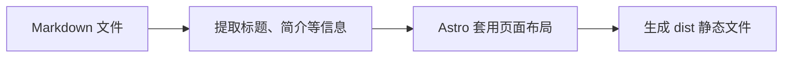
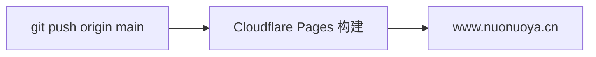

# 儒雅的诺诺的学习基地

AI Coding 与日常学习的分享站，地址是 [www.nuonuoya.cn](https://www.nuonuoya.cn)。

纯静态站点：Astro 5 构建，Cloudflare Pages 托管，没有后端和数据库，文章就是仓库里的 Markdown。

## 站里有什么

| 页面 | 内容 |
| --- | --- |
| 门户 `/door/` | 每个会话第一次进站时的 3D 黑洞场景，点黑洞穿过视界进入首页 |
| 首页 `/` | 可拖动、缩放的思维导图，五个分类展开成文章书架 |
| 分类 `/project/` 等 | 项目、工具、探究、日常、小萌五个分类，可搜索、翻页 |
| 文章页 | 目录、阅读进度、代码复制、Mermaid 图、伴奏音乐、Markdown 原文下载 |
| 标签 `/tags/` | 按拼音首字母分组的全部标签和热度榜 |
| 公告 `/notice/` | 右上角小铃铛进入，最新公告 24 小时内亮红点 |
| 游戏 `/game/` | 游戏大厅，目前有「果冻 2048」和「鹈鹕骑车」两款 |
| 关于 `/about/` | 个人介绍 |

## 鹈鹕骑车

鹈鹕骑着小自行车兜风：一条长路连着穿过十二处风景，沿路用大嘴兜小鱼，不会输。每一局的场景顺序和路形都是随机的。

- 画面全部程序生成（three.js 加简单几何体），没有贴图和模型文件
- 音效和背景音乐用真实乐器采样渲染（`scripts/game-audio/pelican.py`），再用 `scripts/game-audio/upload.py` 传到 OSS 的 `personal_website_other/`（仓库里不存 mp3）；打开游戏页面就开始下载
- 成绩只存在本机浏览器

## 果冻 2048


软体物理版的 2048：数字是会挤、会变形、会 Q 弹的果冻。按住托盘里的果冻往外拉，松手弹进下面的井里，相同数字碰到一起就合成，别让果冻越过虚线。

- 物理是手写的位置动力学软体（`src/game/jelly/physics.ts`），没有引第三方引擎
- 合成音效用 Web Audio 现场合成，连锁合成时画面和声音一起慢放
- 成绩只存在本机浏览器；误刷新 15 分钟内回来能接着玩，点链接离开会先确认再结算

## 写一篇文章

文章放在 `src/content/<分类>/` 下，**不写 frontmatter**，元信息直接写在正文开头：

```markdown
# 我的项目笔记

> 这次做了什么，遇到了什么问题。

> tags: [Astro, 静态网站]

> date: 2026-10-29

## 从这里开始写正文
```

- 标题取第一个一级标题，简介取紧跟的引用，分类取所在文件夹
- 可选的行：`github:` 仓库、`bilibili:` 视频、`music:` 伴奏
- 图片一律用 OSS 完整外链；文件名以 `_` 开头的是草稿
- 发布日期以 `date:` 为准，改错字不用动它

完整格式见 [文章模板](./src/content/content_format.md)、[个人介绍模板](./src/content/profile_format.md) 和 [公告模板](./src/content/notice_format.md)。



## 本地运行

需要 Node.js 22：

```powershell
npm install
npm run dev
```

开发地址是 `http://127.0.0.1:4321`。`astro dev` 不运行 Pages Functions，所以本地没有进站验证。

```powershell
npm run build
npm run preview
```

## 上线

推送到 GitHub 的 `main` 分支，Cloudflare Pages 自动构建（`npm run build`，输出 `dist`）并发布，大约一分钟。



<details>
<summary>几处值得知道的实现细节</summary>

- **文章日期**：Pages 构建时是浅克隆，`scripts/unshallow.mjs` 先补全 Git 历史，否则没写 `date:` 的文章日期全会变成推送那天
- **搜索**：构建时给每个分类生成 JSON 全文索引，搜索框第一次获得焦点时才拉取，浏览器里直接筛选，不需要后端
- **进站验证**：Pages Functions 里的中间件把没有有效 Cookie 的访问送到 `/gate/` 做 Turnstile 验证，通过后下发 24 小时的 HMAC 签名 Cookie。两个 Secret 没配齐时直接放行，避免把站点锁死
- **门户页**：three.js 只在 `/door/` 加载。黑洞是全屏光线步进着色器，探测器和空间站按开普勒轨道运行，几何体也按引力透镜公式偏折，画面全部程序生成
- **域名**：DNS 留在阿里云，`www` CNAME 到 Pages，裸域 301 到 www，HTTPS 由 Cloudflare 提供

Pages 需要的环境变量：

| 变量 | 用途 |
| --- | --- |
| `PUBLIC_TURNSTILE_SITE_KEY` | 构建进验证页的公开 Site Key |
| `TURNSTILE_SECRET_KEY` | 服务端校验 token |
| `GATE_COOKIE_SECRET` | 签名与校验放行 Cookie |

</details>

修改代码前先读 [AGENTS.md](./AGENTS.md)，里面是当前的约定和踩过的坑。
