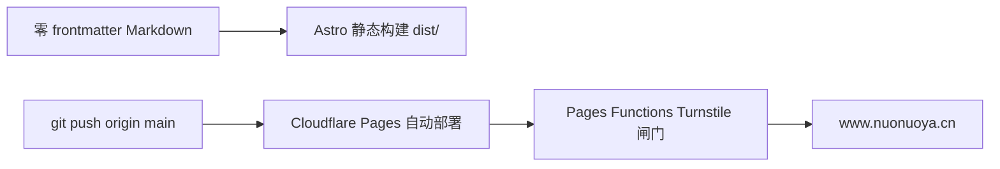

# 儒雅的诺诺的学习基地

AI Coding 与日常学习的个人博客站，在线地址：[www.nuonuoya.cn](https://www.nuonuoya.cn)。  
基于 Astro 5 生成纯静态站点，由 Cloudflare Pages 自动构建托管，无后端、无数据库。

## 站点一览

| 入口 | 说明 |
| --- | --- |
| 门户 `/door/` | 首次进站触发的程序生成 3D 黑洞甲板与「斯隆长城」五系星图 |
| 首页 `/` | 可拖拽缩放的思维导图画布，按分类展开文章书架 |
| 内容分类 | `project`、`tool`、`explore`、`daily`、`xiaomeng`，支持客户端全文检索与分页 |
| 标签 `/tags/` | 跨分类标签索引、拼音分组与常用热度榜 |
| 公告 `/notice/` | 三栏公告中心，支持 `xiaomeng` / `post` / `link` 卡片与 24h 新帖红点 |
| 游戏 `/game/` | 游戏大厅，支持昼夜双封面切换、规则弹窗与实机画册 |
| 关于 `/about/` | 个人简介与技能标签 |

## 最新游戏：星海漫游


直接依托门户页的「斯隆长城」五座星系与黑洞光学底座打造的 3D 太空巡航小游戏：

- **等长随机漫游航线**：每次开局保留五座已知星系必经点并洗牌顺序，通过二分求解锁定恒定 `~745 Mpc` 宏大航程，每局都是新路线
- **天体物理与真空推进**：共面差速分子尘埃、十八座电磁捕获星门、三段开普勒引力弹弓与奥伯特近心加速，配真空膨胀羽流与 Web Audio 实时合成声场
- **漫游艇与图鉴收藏**：金箔旅者 / 纸鸢流萤 / 蓝鲸穿梭三款涂装可选；拾取 25 件藏品后就地缩小并沿抛物线飞入「图鉴」按钮，成绩保存在本机浏览器

## 写作约定

正文直接写在 `src/content/<分类>/` 的 Markdown 文件里，**不写 frontmatter**：

```markdown
# 文章标题

> 一句话简介


> tags: [Astro, 静态网站]
> date: 2026-11-17

正文内容……
```

- 第一个 `#` 为标题、紧跟的 `>` 为简介、所在目录名即分类；文件名以 `_` 开头为草稿
- 支持可选元信息：`github:` 仓库、`bilibili:` 视频、`music:` 伴奏、`speech:` 朗读
- 模板参考：[文章](./src/content/content_format.md) · [关于](./src/content/profile_format.md) · [公告](./src/content/notice_format.md) · [游戏](./src/content/game_format.md)

## 本地运行与上线

环境要求 **Node.js 22**：

```powershell
npm install
npm run dev      # http://127.0.0.1:4321（不跑 Pages Functions）
npm run build    # node scripts/unshallow.mjs && astro build → dist/
npm run preview
```



> 修改代码或内容规范前请先阅读 [AGENTS.md](./AGENTS.md)。
