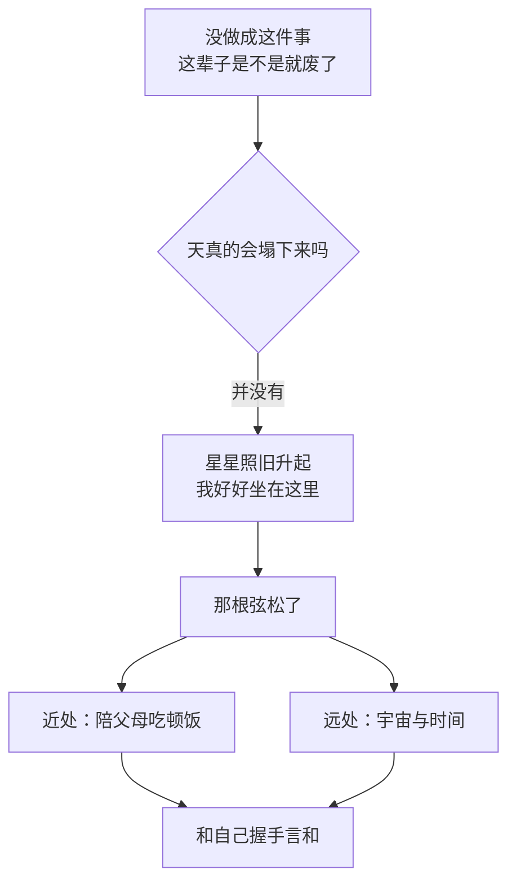
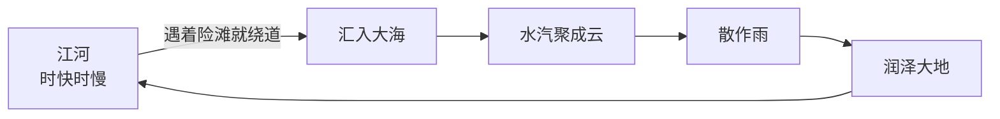

# 人生没有标准答案

> 行到水穷处，坐看云起时

***

***

> tags: [随笔, 人生, 焦虑, 和解, 家人, 陪伴]

总觉得这一生，走得像一场误打误撞的远游。

白日的市声总是喧腾的。车马劳顿，人影杂沓，周遭的一切都在催着人往前赶。为了不显突兀，也为了让身边人安心，我渐渐学会了把轻松散漫的面具戴在脸上，学着应付那些家长里短，扮出一副无甚关碍的洒脱模样。

唯独到了更深人静、万籁俱寂的时候，心里那扇平时锁得紧紧的柴扉，才敢悄悄推开一条缝。

门后的光景并不凄清，反倒盛满了沉甸甸的思绪。我常在暗夜里问自己，这条名为人生的长途，究竟要跋涉多久，才能真正看透其中的关窍？抬眼望去，世人皆在名利场中争渡，在无形的试卷上蝇头细书，把履历填得满满当当，生怕错落半步便成了落伍者。过往的我，也常常被这股无形的鞭子驱赶着，动辄惶恐于“若是不曾达成此事，我这一生是不是就废了”。那种逼仄的焦虑，像是在一座四面碰壁的死胡同里兜兜转转，不见天日。

直到某一刻，凭窗凝神，忽然一个激灵：莫非天真的要塌下来不成？

并没有。疏星照旧升起，晚风依旧拂过树梢，我手足俱在，神思清明，安安稳稳地坐在原地。

也就是那一刹，紧绷了半生的弦，松了。原来我们自幼习得的规矩，不过是世人设下的科考，误把旷野当成了答题卡，总觉得没踩准别人的步点便是交了白卷。可天地何其辽阔，人怎么就非得活成同一个模样？

功名利禄、锦绣前程，不过是借以安身立命的盘缠罢了。丢了可以再挣，慢了可以再寻，唯独自家心头那点灵气、那只不肯驯服的飞鸟，才是万万丢不得的。若为了挤进某种模具，把自己生生削去棱角，磨成一颗毫无知觉的螺丝钉，才是真正的暴殄天物。

收回远眺的目光，重新落回眼前这碗烟火人间。双亲鬓角的华发添了又添，步履也日渐蹒跚。庭前的花谢了，来年还能再开；可父母老去的速度，却是一条永不回头的单行道。比起那些虚无缥缈的宏愿，能安安静静地陪二老吃顿粗茶淡饭，听他们唠叨几句家长里短，这触手可及的暖意，才是岁月最厚重的馈赠。

若把眼光放得更远，顺着浩瀚的宇宙与无垠的时间望去，人世间的蝇营狗苟、悲欢聚散，不过是沧海一粟。世人总在围城里顾盼艳羡：忙碌的羡清闲，寒微的羡豪富，立在潮头的又觉高处不胜寒。转了一大圈才恍然，这世上根本没有绝对无忧的去处。

既然草木枯荣终归尘土，天地间也并未颁下什么金科玉律，非要逼着每一株树长成栋梁。那么来这世间走一遭，本义便不是为了向谁交出一份满分答卷，而是为了真切地“经历”这山河岁月。

与那个和世俗有些格格不入的自己握手言和吧。走得慢些，无妨；中途累了，倚着树桩歇息片刻，也无妨。

人生如大江东去，时快时慢，遇着险滩暗礁便绕道而行，只要水流未绝，终归要汇入浩瀚的大海。而海上的水汽，聚则为云，散则为雨，兜兜转转，又润泽了大地。

我终究是爱这人间烟火的，庆幸自己曾来此处听过风、看花开。至于此后余生流向何方，不必急于求答案。只要心中的鸟儿还在振翅，所爱的人仍在身侧，这细水长流的日子里，每一步，便都是好风景。