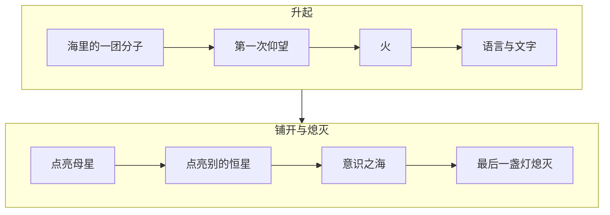
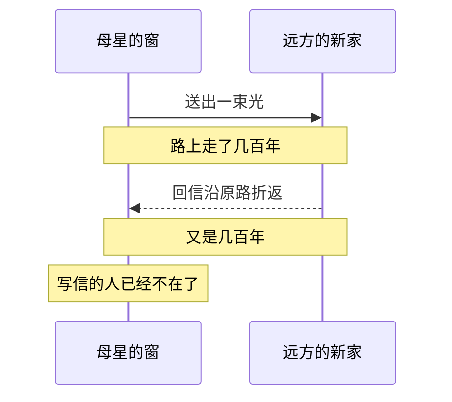
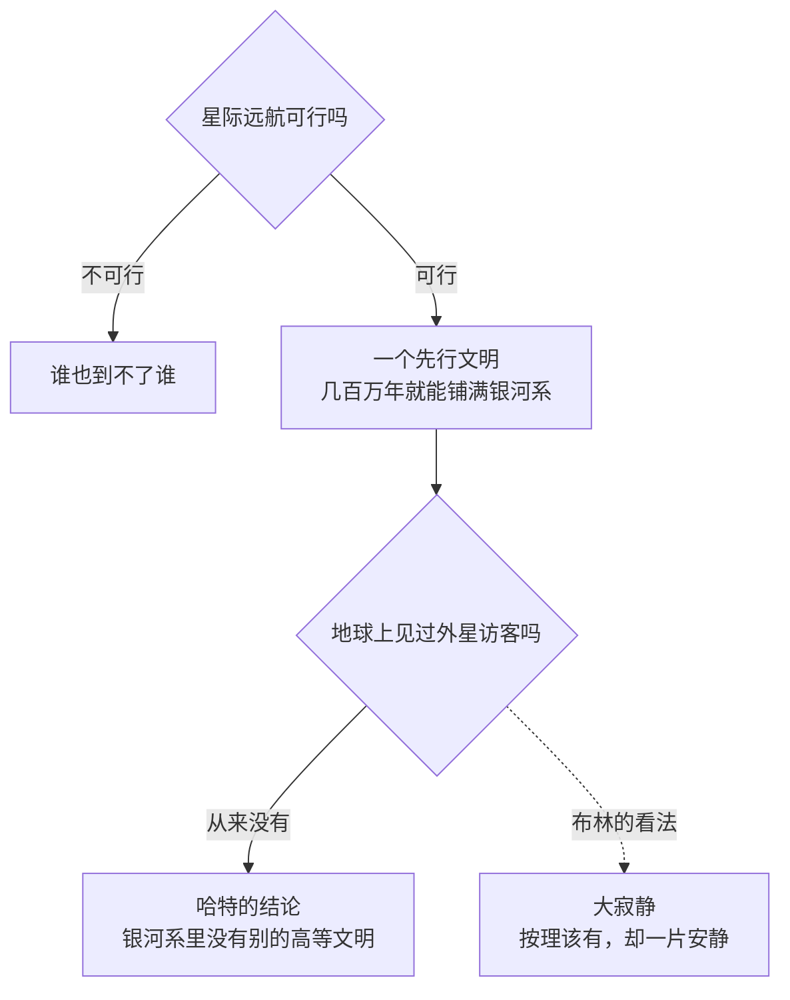
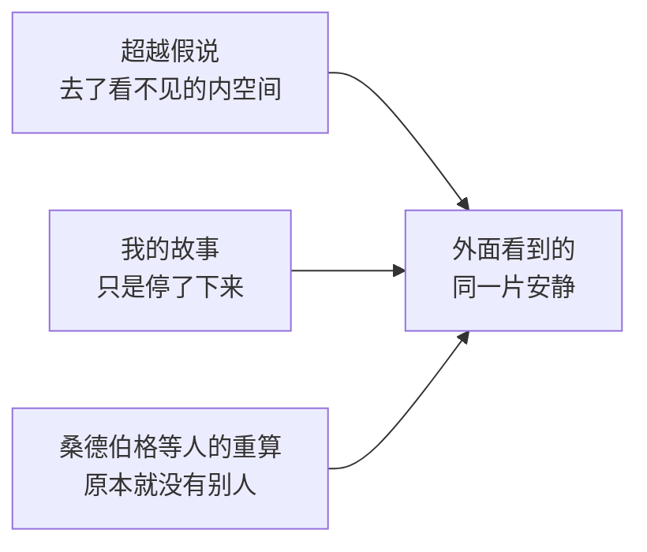

# 文明之火，在星海里有多小

> 我想讲一个文明的故事：它从海里的一团分子起步，学会用火、写字，点亮母星，再去点亮一颗颗陌生的恒星，最后在自己造出的「意识之海」里安静熄灭。而星海自始至终，分毫未变。这篇文字，是我为讲述这个故事一路查考、一路推演的记录

---

---

> tags: [文明, 宇宙, 费米悖论, 卡尔达肖夫等级, 超越假说, 暗淡蓝点, 随笔]
> bilibili: https://www.bilibili.com/video/BV1WLHM6DEH9/

## 一、一个故事是怎么冒出来的

故事最初只是一个模糊的念头：我想写一个文明从诞生、壮大到极盛，随后在漫长的岁月里被时间磨蚀，又执拗地向深空无限扩张，最终因为某种意想不到的造物走向消亡。

那个「意想不到的东西」，起初我设想为类似如今的 AI，但又不属于同一个维度。它是文明亲手锻造的产物，是跃迁向更高层级的钥匙，却也成了文明的终点。

越往下写我越发觉，我真正想说的并非「文明终将毁灭」，更不是在预言人类的结局。我想捕捉的是另一种体量悬殊带来的震颤：一个文明哪怕轰轰烈烈地铺满了数千光年，一旦投进宇宙这片无边无际的深林，它的火光依然微弱得可怜。

文明谢幕了，星海依旧闪烁。万物如常，仿佛什么都不曾发生。

那种难以名状的旷远与寂寥，才是我真正想落笔的东西。

整个故事的走向，大致是这样两段：

## 二、先看清舞台有多大

要写出渺小，必先丈量宏大。我们身处的银河系究竟有多少颗恒星？从未有人真正数清——因为我们自己就深陷在银盘之中，视线所及，大片星域都被星际尘埃遮蔽。天文学家只能依靠推算：按欧洲南方天文台给出的数据，大约在一千亿到四千亿颗之间。

那么，宇宙中又有多少个如银河系这般的星系？上世纪九十年代，哈勃望远镜对准一小块看似空无一物的夜空长时间曝光，拍下了著名的「哈勃深场」；彼时估算，可观测宇宙约有一千亿到两千亿个星系。到了 2016 年，研究团队将那些暗弱到现有设备尚无法直接观测的小星系一并纳入模型，这个数字骤然攀升至约两万亿个。

所以在故事开篇，我写下这几句：几千亿颗恒星，聚成一条星河；数不清的星河，散在无边的黑暗里。

星河与星河之间，隔着怎样的深渊？离我们最近的大型星系是仙女座星系，光从那里启程，要在虚空中狂奔约两百五十万年，才能抵达地球。今夜我们抬头望见的仙女座，其实是它两百五十万年前的旧影。而在那个年代，地球上甚至还没有演化出「人」这个物种。

把这几个数字排成一条线，每往右一格，尺度都要翻好几个数量级：

后来，我特意将视频的第一帧与最后一帧设为同一张底片——哈勃望远镜拍摄的「超深场」。画面里的每一个微小光斑，几乎都是一整座庞大的星系。我想让观众在片尾骤然意识到：方才那几分钟里上演的整部波澜壮阔的文明史，搁在这张底片上，连一个像素都占不满。

## 三、生命从哪一刻开始算

故事里的文明，始于「海里一团学会自我复制的分子」。这并非凭空杜撰。生物学界有一个影响深远的假说，名为「RNA 世界」：最初的生命，或许是一种既能承载信息、又能自我催化化学反应的分子；它率先掌握了复制的本能，此后才逐渐演化出 DNA 与蛋白质。这一假说由吉尔伯特于 1986 年正式命名，至今仍停留在推演阶段，尚未有人能在实验室里完整复现那条漫长的演化之路。

而地球上已知最早、且较为可信的生命印记，是封存在约 34.8 亿年前古老岩层中的叠层石。更古老的痕迹虽有人提出，但至今仍存争议。

我格外偏爱这段历史在科学上的留白：生命究竟如何点燃，我们无从确知，只知道它确凿地开始了。于是在故事里，我只克制地写了一句：「有东西动了。」

随后，它感光，登岸，仰起头，生平第一次望见了浩瀚夜空。

它并不知道漫天光点是什么，只是本能地觉得，那里很远，很好看。

这或许就是一个文明最初的「仰望」。在我的构想里，日后一切横跨星海的宏伟，皆源于这微不足道的一瞥。

## 四、火、语言和文字：文明开始「记得」

紧接着是火。火驱散了长夜，让渺小的生灵得以围坐一处，倾诉白日里未曾言说的话语。我在画面里埋了一个细节：第一簇火种，正是从那生灵背上的微光中跃出的。此后无论是蔓延大地的城池灯火，还是点亮星图的航标，皆由这一星暖色衍生而来。冷色调归于苍茫宇宙，暖色调归于微弱文明——这是我为整部作品定下的视觉底色。

再往后，语言与文字诞生了。语言，将一具躯壳里的念头渡入另一片脑海；文字，将一代生灵的求索托付给后世。

这才是文明真正跨过的分水岭。在此之前，个体习得的一切经验，都会随肉身的消亡而归零；有了文字，认知便挣脱了单一生命的寿数限制，在世代更迭中垒土成山。

因此，这一节收束于短短一句话：自此，它们不再只是活着；它们开始记得。

## 五、宏伟：一个文明能大到什么程度

当文明的火光燃起，它究竟能扩张到何种境地？

1964 年，苏联天文学家卡尔达肖夫提出了一套以能量驾驭规模为准绳的文明分级标尺：

卡尔达肖夫当年定义 I 型文明时，直接以地球当时的总能耗为基准；后来卡尔·萨根将其扩展为连续的对数刻度，如今通称的 I 型文明，意味着能够掌控整颗母星接收到的全部能量。按此标准，今天的人类甚至尚未真正迈入 I 型门槛。而 II 型文明，便是故事里所写的「收拢整颗恒星的光」——例如构筑一座庞大的「戴森球」，将恒星彻底包裹，榨取其全部光热。物理学家弗里曼·戴森早在 1960 年便提出过一个精妙的推论：倘若宇宙中真有此类工程，被包裹的恒星会将可见光转化为强烈的红外辐射，人类尽可用红外望远镜去搜寻它们的踪迹。

在我的故事里，那个鼎盛时期的文明，疆域辽阔到「光从一端走到另一端，也要几千年」。然而在核对天文学数据时我才恍然惊觉：即便庞大至此，它距离 III 型文明依然遥不可及。银河系的直径足有十万光年，数千光年的版图嵌在其中，不过是一隅之地。

换言之，一个在人类想象力极限中已然辉煌到极致的星际帝国，放进一座星系里，也仅仅点亮了一小截旋臂的边缘。

## 六、时间的尘埃：宇宙不急着回答

故事行至中段，配乐骤然抽空。画面上浮现出一句话：可宇宙，并不急着回答。这一章，我想写空间尺度对生命造成的绝对孤立。

距太阳最近的恒星是比邻星，相隔约 4.25 光年，连光都要走上四年有余。倘若搭乘人类目前最快的造物——时速逼近 70 万公里的帕克太阳探测器前往，单程便需漫长的 6600 年。

故事里的文明远比人类强大，它们的飞船跨越星隙「只需」数百年。可仅仅数百年，就足以将一封家书变成一场宿命的悲剧：讯息发往深空，待回音跨越光年归来，当年执笔的人早已化作尘土。

为此，我在片中设计了一扇方窗：窗内独坐的身影，将一束微光投向遥远的新星；漫长的岁月流逝后，回信顺着原路折返，而那扇亮光的窗前，早已空无一人。

再往后，时间如细密无声的微尘，落满万物。坚硬的碑石被岁月磨平，显赫的名字在流传中佚失，到最后，连最初的母星位于何方，都要翻检残破的古星图才能勉强辨认。

这是文明第一次在骨子里感到自身的渺小——并非源于技术的孱弱，而是因为宇宙太广袤了，广袤到连它最迅捷的讯息，也跑不过生命枯萎的速度。

## 七、可它们没有停步

许多关于深空的故事写到这里，会让文明心生怯意、退回母星。但我的故事没有。

或许是出于不甘，又或许只是顺着向前的惯性，它们依然在陌生的恒星旁接连安下家园：赤红的荒漠、冰封的卫星、不见寸土的汪洋水球、一面永昼一面永夜的潮汐锁定之地。一颗，十颗，一千颗，在无边的暗夜里次第点灯。

写及此处，一个盘桓已久的疑问也随之浮现：倘若文明真能这般跨越星海、繁衍生息，为何我们举目四望，整个银河系却看不见半点异星的灯火？

这便是著名的「费米悖论」。1975 年，天文学家迈克尔·哈特发表了一篇逻辑冷峻的论文：只要星际远航在物理上可行，任何一个先行文明只需短短数百万年便能填满银河系；既然地球从未迎来外星访客，最直截了当的推论便是——银河系中根本不存在其他高等文明。1983 年，天体物理学家兼科幻作家大卫·布林撰文梳理这场漫长的争论，将这种「按理应当万家灯火，实则万籁俱寂」的诡异图景，命名为「大寂静」（The Great Silence）。

哈特的推理其实只有三步，布林在最后一步停了下来，没有急着下结论：

我极其钟爱这个译名。宇宙并非空无一物，它只是太安静了。

## 八、跃迁：那片意识之海

故事的终局转折，始于那个文明「唤醒了一种新物质」。

那既非冰冷的机械，亦非脆弱的血肉，而是一片能让意识直接交融的海洋。相隔数千光年的两个世界，得以在其中汇成同一个念头。久而久之，万千思绪彻底相融、再难剥离；世间不再有「你」与「我」的界限，不再需要跨越深空的飞船，也不再需要留存记忆的文字。

当万物之理皆已通晓，一切渴求皆有回响——继续向前跋涉这件事，骤然失去了意义。

坦白而言，这一章纯属我的文学遐想，并非严谨的科学推论。因此在视频的这一节开头，我特意标注了一行小字：「以下是一种想象。」

但在翻阅文献时，我惊讶地发现，科学界确实有人严肃探讨过相似的终局。2012 年，学者约翰·斯马特提出了「超越假说」（Transcension Hypothesis）：高度发达的文明或许不会无休止地向深空扩张，而是掉头向内，钻进物质、能量与时空尺度都极致致密、极致微小的「内空间」，最终走向近似黑洞的归宿。在他的推演中，外部浩瀚的宏观宇宙，对这类高阶文明而言将变得日趋重复、贫瘠且乏味。

这固然不同于我笔下的「意识之海」——斯马特指向的是向内坍缩，而非停止探索。可当读到「外部宇宙变得乏味」那一句时，我心底依然生出一丝寒意：或许一个文明走到极致，最深沉的危机既非强敌环伺，亦非天灾降临，而是它穷尽了所有未知，再也找不到继续向前的理由。

倘若再向人类思想史深处追溯，「万千心智汇流为一」的意象，最早可见于法国哲学家德日进提出的「智力圈」（Noosphere）。这一概念萌芽于上世纪二十年代，后凝练于其 1955 年出版的遗作《人的现象》中。那虽是哲学思辨而非实证科学，却足见人类很早便已在仰望星空时，隐隐预见了这样一种精神归宿。

## 九、熄灭：没有交火，也没有挣扎

于是，故事里的文明以这样的方式迎来了落幕：没有交火，也没有挣扎。那些绵延数千光年的灯火，只是不必再亮着了。

先是遥远的边疆，再是繁忙的航道，最后是古老的母星。

最后一盏灯熄灭时，没有谁看见。

剪辑视频时，我将这一帧精准卡在了配乐彻底消散、归于绝对无声的那一秒。画面上只有夜色缓坡顶上的一座小小屋舍，唯一亮着暖黄微光的窗户轻轻一闪，便彻底暗了下去。

在这里，我特意将三种截然不同的假说并置，只因它们投射在外部观察者的眼中，结局毫无二致：

- 也许它们遁入了人类无法观测的微观维度——这是「超越假说」的推演。
- 也许它们在彻底圆满后主动选择了停步——这是我笔下的故事。
- 也许从始至终，这片星海里就没有过别人——2018 年，桑德伯格、德雷克斯勒与奥德三位学者将估算外星文明的德雷克方程参数，代入真实的概率分布重新推演，得出的结论令人凛然：整个可观测宇宙中唯有我们孤身一人，这种可能性其实相当高。

无论真相属于哪一种，从幽暗的深空望去，留给宇宙的都只是同一片死寂。

## 十、从稍微远一点的地方看过去

1990 年 2 月 14 日，即将飞出太阳系的旅行者 1 号在约 60 亿公里外最后一次回眸，为地球拍下了一张照片。在那幅漆黑的底片上，承载了全部人类历史的地球仅占 0.12 个像素，微弱得如同悬浮在一束散射光里的纤尘。后来，卡尔·萨根赋予了它那个永恒的名字——「暗淡蓝点」。

这部短片的结尾，我正是想带观众退回到那个遥不可及的视角。

宇宙还是原来的样子。光从一条星河出发，还在走它那几百万年的漫漫长路。那片曾经轰轰烈烈、铺满数千光年的璀璨灯火，搁在无垠星海里，不过是白驹过隙的一瞬。只需将视线稍微拉远少许，这片星域便平静得宛如什么都未曾发生。

我在片尾埋下了一个首尾咬合的细节：开篇那束从遥远星河启程的星光，直到全片落幕，依然行走在同一条旅途上，仅仅向前挪动了微不足道的一小步。一个文明从单细胞苏醒到星际帝国熄灭的整部史诗，对一束跨越星系的光而言，几乎不曾消耗时间。

随后，镜头彻底拉远，严丝合缝地落回第一帧——那张真实的哈勃超深场。

星海很亮，也很安静，就像一直以来的那样。

## 十一、我最后想明白的事

写完这个近乎虚无的故事，我心底反而褪去了悲观。

人类文明同样只是深空里的一簇微火。它如此渺小，如此短暂，在百亿年的星海里，大抵也只能明灭一瞬。可正因为宇宙这般浩瀚、这般冷寂，这一星半点的暖光才显得尤为孤绝而珍贵。亿万年前那个初登陆地的生灵第一次仰头时，觉得夜空「很远，很好看」——这句话跨越漫长的演化落在今天的我们身上，依然字字成立。

宇宙永远不会记得我们，但我们曾仰望并记得宇宙。在这片沉默的星海里，这大概就是一个渺小的文明所能做到的，最了不起的事。

## 参考资料

- 银河系恒星数量：ESO（2019）；NASA Science「Star Basics」
- 可观测宇宙的星系数量：ESA/Hubble heic1620（2016）；Conselice 等，*ApJ* 830, 83（2016）
- 仙女座星系距离：NASA Hubble Messier 31 条目；Li 等，*ApJ*（2021）
- 比邻星距离：Gaia DR3（ESA，2022）；帕克太阳探测器速度：NASA / 约翰斯·霍普金斯大学应用物理实验室（2024）
- RNA 世界：Gilbert，*Nature* 319, 618（1986）；最早的生命证据：Djokic 等，*Nature Communications* 8, 15263（2017）
- 文明等级：Kardashev，*Soviet Astronomy* 8, 217（1964）；Dyson，*Science* 131, 1667（1960）
- 费米悖论与大寂静：Hart，*QJRAS* 16, 128（1975）；Brin，*QJRAS* 24, 283（1983）；Sandberg、Drexler、Ord，arXiv:1806.02404（2018）
- 超越假说：Smart，*Acta Astronautica* 78, 55（2012）
- 智力圈：Teilhard de Chardin，*The Phenomenon of Man*（1955）
- 暗淡蓝点：NASA/JPL，PIA00452（1990）
