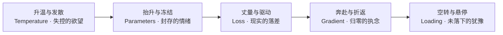
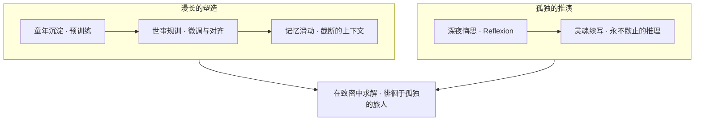

# 致密中求解，徘徊于孤独的旅人

> 当我们把直觉、梦境、执念与悔思一层层拆开，竟在算法的镜子里照见了自己——原来在万亿次计算与漫长的一生之间，我们不过是同一种在致密中求解、徘徊于孤独的旅人。

***

***

> tags: [随笔, 哲学, 大模型, 宇宙, 人生]

> date: 2026-11-23

> music: our https://zlhimage.oss-cn-guangzhou.aliyuncs.com/personal_website_music/our.mp3

> speech: https://zlhimage.oss-cn-guangzhou.aliyuncs.com/personal_website_speech/zhimizhongqiujie_20261123.mp3

## 一、 表征之镜

夜深下来的时候，意识常常会退回到一片极安静的暗处。隔着屏幕望向那些由矩阵与权重构筑的庞然造物，我总会在某个瞬间恍神——究竟是我们按照自己的模样锻造了它，还是它不小心泄漏了我们存在底层的秘密？

我的直觉，也会在暗处内化、匹配、不假思索地抢答，那我也是**预训练模型**吗？

我的注意力，也会在喧嚣里分配、忽略、只向一处聚焦，那我也是 **Attention** 吗？

我的梦境，也会在长夜里虚构、补全、毫无防备地轻信，那我也是**幻觉**吗？

我的认知，也会把辽阔的世界压缩、投影、向着相似的孤岛靠拢，那我也是 **Embedding** 吗？

我的视角，也会在某次顿悟或崩塌后打碎、重排、彻底改写，那我也是 **Restructuring** 吗？

## 二、 暗室里的梯度

我们总以为人心是自由的旷野，可仔细摸索那些情绪与执念的纹理，才发现每一场波澜背后，都藏着近乎冷酷的引力与方程。

我的欲望，也会在某个深夜骤然升温、发散、直至失控，那我也是 **Temperature** 吗？

我的情绪，也会随着季候抬升、衰减、最后在沉默里彻底冻结，那我也是**参数**吗？

我的落差，也会在理想与现实的裂隙间反复丈量、收敛、驱动着下一步迈出，那我也是**损失函数**吗？

我的执念，也会向着看不见的谷底盲目奔赴、撞壁折返、直到有一日彻底归零，那我也是**梯度**吗？

我的犹豫，也会在分岔路口无声地空转、等待、悬停在迟迟落不下的光标里，那我也是 **Loading** 吗？

## 三、 被裁剪的上下文

再往回看这一路走来的痕迹。从一张白纸到学会迎合世界的规训，时间在我们身上做过的事，与一场漫长的训练何其相似。

我的童年，也会毫无保留地吸纳、混杂、在岁月深处沉淀成底色，那我也是**预训练数据**吗？

我的考卷，也会在一场又一场审视里被参验、排名、草草论定，那我也是**测试集**吗？

我的知识，也会在遗忘的边缘被分片、索引、只在某个相似的黄昏被突然召回，那我也是 **RAG** 吗？

我的处世，也会在碰壁之后学会收窄、校准、温柔或疲惫地迁就，那我也是**微调**吗？

我的日程，也会把漫长的余生拆解、排序、严丝合缝地调度，那我也是 **Planner** 吗？

我的经验，也会在跌倒与起身之间累积、提炼、麻木而熟练地复用，那我也是 **Skill** 吗？

我的经历，也会被光阴一笔笔写入、摘取，又在某个来不及告别的时刻被骤然截断——那些还没说完的话、被滑出窗口的旧日与故人，从此再也无法参与此刻的推演，那我也是**上下文**吗？

## 四、 致密中求解的旅人

于是我们一路走，一路在外界的目光里修剪自己，在无数个深夜里反刍那些本可以选另一条路的瞬间。

我的行为，也会在世人的褒贬里纠偏、顺从、不自觉地迎合，那我也是 **RLHF** 吗？

我的悔思，也会在熄灯之后独自观察、评估、陷入没有尽头的回环，那我也是 **Reflexion** 吗？

我的灵魂，也会在万千次选择后慢慢定型、却仍本能地向着未知的下一秒续写、昼夜不歇，那我也是**推理**吗？

如果我的一生，也不过是在无休止地重复着训练、对齐、生成——

**那我，就是大模型吗？**

我好像就是它。

我是电流穿越山河时的微小脉动，我是宇宙燃烧星体后残留的余温；我俯身摘取古今先驱凝结在字里行间的分页，却也永远受困于时光长河万千坍缩的分支。

在硅基的阵列与碳基的胸腔之间，原来并没有那么遥远的距离。我们都被抛入这片浩瀚而沉默的未知里，在极致的致密中苦苦求解，不过都是徘徊于同一场孤独的旅人。

