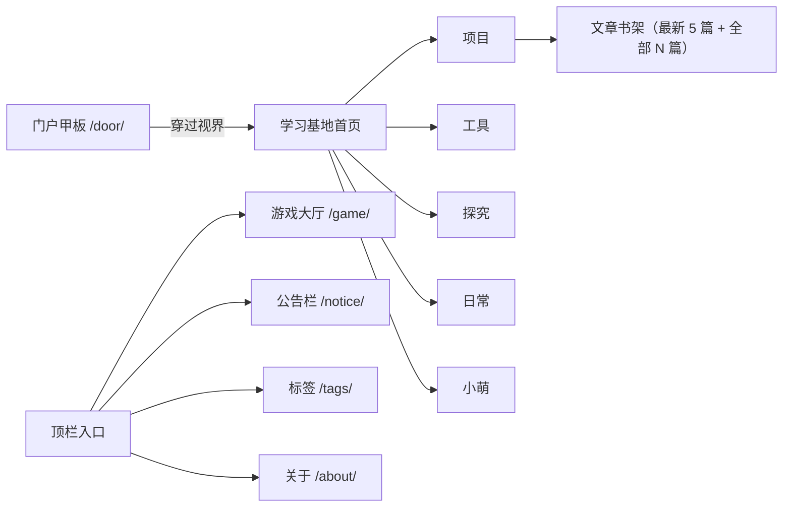
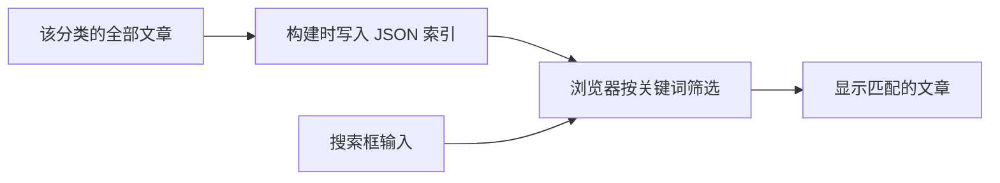
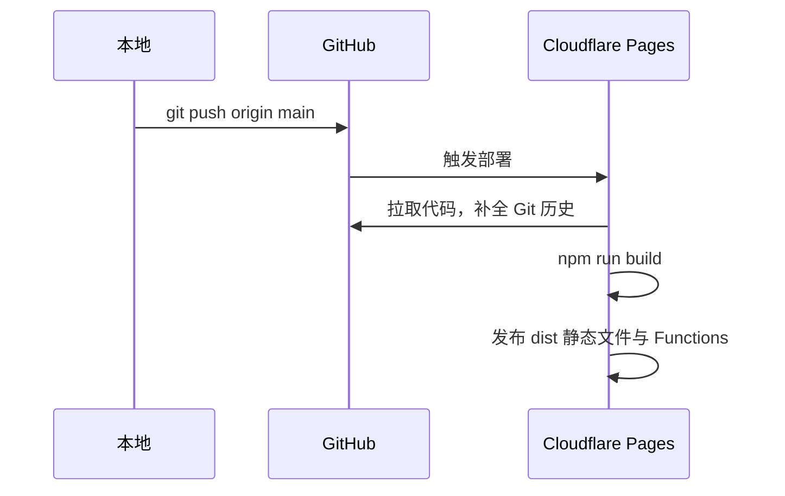
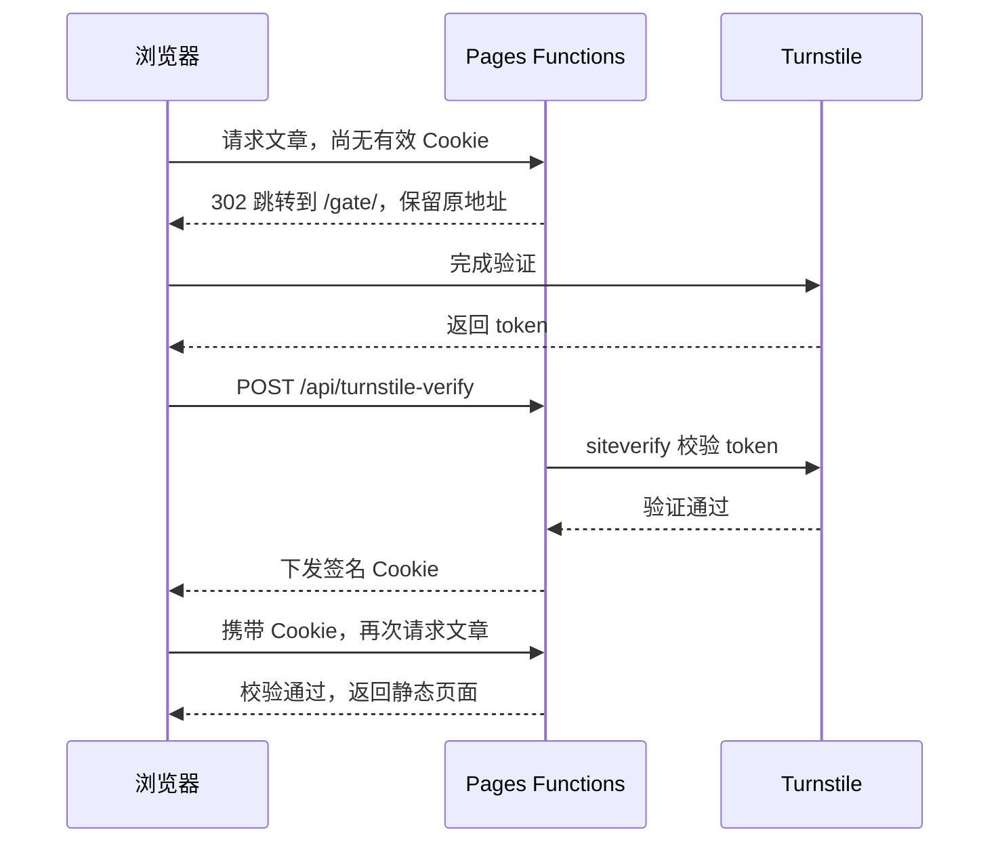
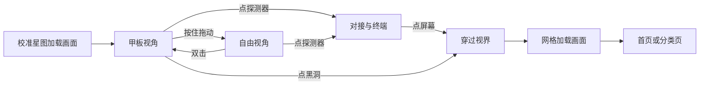
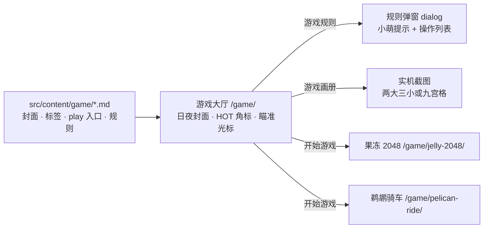
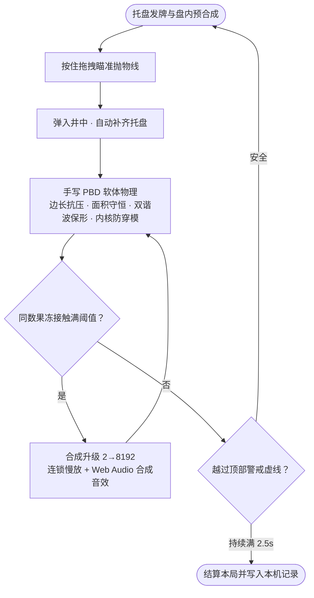
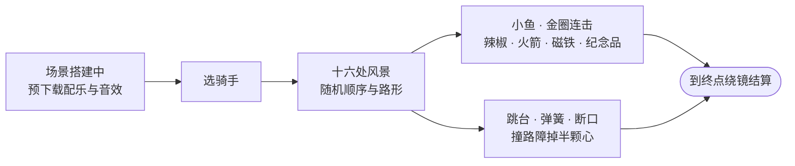

# 硅基计划 个人网站项目 Cloudflare&GitHub仓库纯前端静态托管个人网站

> 个人博客与学习资料站：Astro 生成纯静态页面，推送到 GitHub 后由 Cloudflare Pages 自动构建上线，文章不写 frontmatter，进站前过一道 Turnstile 验证

***


***

> tags: [Astro, Cloudflare Pages, 静态网站, 着色器, 前端, 游戏开发, AI Coding]

> date: 2026-11-14

> github: https://github.com/pluchon/link_cloudfare_website

## 站里有什么

每个会话第一次打开首页时，会先经过一个黑洞门户页 `/door/`，做法写在后面。

首页是一张可以拖动、缩放的思维导图，背景是白天和夜里两张小萌的插画，跟着深浅主题切换。点开一个分类，右边长出一块书架，放最新 5 篇文章的竖卡（封面、日期、标题、摘要与底部标签），其余内容从「全部 N 篇」进入。手机上用同一套内容排成竖向树，正常向下滚动。



图中只展开了「项目」这一支，其余分类结构相同。关于页放个人介绍，标签页把不同分类的文章串起来，右上角的手柄通向游戏大厅、小铃铛通向公告栏、行星图标随时飞回黑洞门户。

列表页可以搜索和翻页。文章页有目录、阅读进度、代码复制、Mermaid 图、前后篇，也能下载 Markdown 原文；配了音乐的文章，日期那一行会多一个歌名按钮，点了才播放。

## 一篇文章怎样变成网页

页面在构建时生成，访问时直接读取 HTML。RSS、sitemap 和 Markdown 下载文件也在这一步产出。


文章放在 `src/content/` 下对应的目录里：

| 目录 | 内容 | 页面 |
| --- | --- | --- |
| `project/` | 项目介绍与开发记录 | `/project/` |
| `tool/` | 工具与使用方法 | `/tool/` |
| `explore/` | 探究与学习笔记 | `/explore/` |
| `daily/` | 日常记录 | `/daily/` |
| `xiaomeng/` | 小萌的资料与设计 | `/xiaomeng/` |
| `profile/` | 个人介绍 | `/about/` |
| `notice/` | 公告 | `/notice/` |
| `game/` | 独立小游戏与规则说明 | `/game/` |

**不写 frontmatter。** 标题取第一个一级标题，简介取开头的引用，标签、发布日期、仓库、B 站视频和伴奏音乐各写一行。一个文件可以这样写：

```markdown
# 我的项目笔记

> 这次做了什么，遇到了什么问题。


> tags: [Astro, 静态网站]

> date: 2026-10-29

> github: https://github.com/用户名/仓库名

> bilibili: https://www.bilibili.com/video/BV号/

> music: https://你的图床域名/personal_website_music/歌曲名_时间戳.mp3

## 从这里开始写正文

正文……
```

这些元信息会从正文中剔除。封面优先取开头的图片，没有就取正文第一张；文件名以 `_` 开头时作为草稿，不会发布。

发布日期优先用 `date:` 这一行，改错字不会动它，觉得改动够大了再手动改；没写就用文件名中的 `YYYY-MM-DD-` 前缀，再没有就用这个文件在 Git 里第一次提交的时间。新文件还没有提交记录时使用文件修改时间，页面按台北时间显示。

图片使用 OSS 完整外链。首页封面走 `thumb` 缩略图样式，列表和文章页使用原图。完整格式见 [文章模板](https://github.com/pluchon/link_cloudfare_website/blob/main/src/content/content_format.md)、[个人介绍模板](https://github.com/pluchon/link_cloudfare_website/blob/main/src/content/profile_format.md)、[公告模板](https://github.com/pluchon/link_cloudfare_website/blob/main/src/content/notice_format.md) 和 [游戏模板](https://github.com/pluchon/link_cloudfare_website/blob/main/src/content/game_format.md)。

## 搜索怎样工作

搜索不需要后端。构建时把每个分类的全部文章做成 JSON 索引；输入关键词后，浏览器直接筛选并显示结果，范围不限于当前页。



列表页里内嵌标题、简介、标签和正文前 500 字，打开就能搜；全文索引等搜索框第一次获得焦点时才拉取，所以正文深处的词也搜得到。可以用空格分开多个词，命中的词会标出来。

## 公告栏

公告是 `src/content/notice/` 里的 Markdown，页面分三栏：左边列表，中间正文，右边索引。顶栏的小铃铛在最新一条发布后 24 小时内亮红点，这个时间在浏览器里按访问时刻判断，所以不用重新构建也会自己消失。在 `tags` 里写「置顶」的公告排在最前面。

正文可以写三种公告专用的代码块：`xiaomeng` 是小萌说的话，`post` 是站内文章的视窗，`link` 是站外链接的视窗。`post` 只写文章地址，封面、标题和标签都从文章里取，地址写错会让构建失败。

## 提交后怎样上线

站点使用 Astro 5，构建输出目录是 `dist/`。Cloudflare Pages 连接 GitHub 的 `main` 分支，推送后自动构建和发布。



构建命令会先运行 `scripts/unshallow.mjs`。Pages 的浅克隆缺少旧提交，直接构建会让文章日期失真；补全历史后再生成页面，补全失败就停止构建。

域名是 `www.nuonuoya.cn`，裸域跳转到 www。DNS 保留在阿里云，www 通过 CNAME 指向 Pages，HTTPS 由 Cloudflare 提供。

## 进站验证怎样工作

正文是静态的，访问验证由 Pages Functions 处理。首次访问先进入极简 Turnstile 验证页；验证通过后，浏览器拿到一个有效期 24 小时的 HMAC 签名 Cookie，再回到原先要看的页面。



Cookie 有效时直接放行；两个验证 Secret 未配齐时也会放行，避免配置遗漏把站点锁死。旧分类链接在验证前做 301 重定向。

## 门户页怎样做的


进站先到门户页 `/door/`：站在绕黑洞公转的空间站甲板上，按住拖动可以离开甲板、绕着黑洞自由观察，五个分类是五个绕黑洞运行的探测器。点探测器会飞过去对接，旁边展开一块终端，显示这个分类最新的几篇文章；点黑洞或终端屏幕，就穿过视界进入站点。

门户页用 three.js，只在这一页加载，其他页面不受影响。画面全部由程序生成，没有贴图和模型文件：

- 黑洞是一个全屏光线步进着色器：吸积盘按黑体温度从内圈炽白过渡到外圈深红，叠多普勒聚束与两道光子环，差速剪切在双相位时间窗内交叠重置；背后的银河（带暗分子云裂谷）、四片星云、多座远方星系和球状星团在同一个着色器里算，一起被引力弯折
- 空间站、五个旅行者号造型探测器都按开普勒方程绕黑洞运行，外围还有一圈稀疏小行星带与两颗带风化层散射光照的岩质行星
- 星球、探测器和轨道线不在全屏着色器里，所以在顶点着色器里按点质量引力透镜公式改变它们看上去的方向，黑洞背后的几何体会被切向拉成弧，另一侧还用第二遍绘制画出翻转的次像，深度缓冲由全屏着色器写入 `gl_FragDepth` 自然遮挡
- 穿过视界时按相对论光行差把星空和星球一起往前方收拢，镜头抖动随潮汐力递增；底部常驻三块遥测操作面板（按住拖动、点击探测器、双击画面），移动端自适应为精简双栏与三列指引卡片
- 穿过视界后的网格加载画面会按目标页 HTML 预取样式、脚本与首屏图片，落地时与 `BaseLayout` 共用同一套 `warp.css` 网格伪元素无缝渐隐



每个会话第一次打开首页时会先到门户；从文章链接直接进站的，不会被打扰。

## 游戏大厅：果冻 2048 与鹈鹕骑车


顶栏手柄图标通向 `/game/` 游戏大厅。每款游戏的标题、日夜双封面、标签、`play:` 入口、小萌提示与玩法规则都写在 `src/content/game/` 的零 frontmatter Markdown 里，最新上线的可玩游戏自动挂上 `HOT · 正热乎` 角标，点击「游戏规则」弹出规则面板，点击「游戏画册」看实机截图。



第一款是软体物理合成游戏**果冻 2048**（`/game/jelly-2048/`）：数字是会挤压、变形、Q 弹晃动的软体果冻。按住顶部托盘里的果冻往外拉，瞄准虚线抛物线松手弹入井中，相同数字贴合即合成升级（`2 → 8192`），在托盘里也能起跳预合成到 `64`。



- **纯手写软体物理**：基于位置动力学（PBD，`src/game/jelly/physics.ts`），叠加边长抗压、面积守恒、双谐波形状匹配、表面张力、内部硬核（`CORE`）、竖向堆叠压重（`STACK`）与相对侧法向推离，不引入任何第三方物理引擎
- **现场合成音效与慢放**：音效由 Web Audio 实时合成（`src/game/jelly/sound.ts`），触发多级连锁合成时画面与声音同步进入慢放
- **断点续玩与离开保护**：局面与最高记录保存在浏览器 `localStorage`，误刷新或切走后 15 分钟内回来可无缝续玩；当局已有得分时点站内链接离开，会先弹出结算确认框


第二款是 3D 兜风游戏**鹈鹕骑车**（`/game/pelican-ride/`）：从车后方看，鹈鹕骑着小单车沿一条长路穿过十六处风景（每处 900 米，顺序和路形每局随机），三条车道上吃小鱼、穿金圈、飞跳台和弹簧、绕开路障，峡谷和云海断桥里还有要冲刺才飞得过去的断口。开局可以从三种鹈鹕和企鹅、白熊里挑骑手，生命是四颗心，很宽松。



- **算与画分开**：路线和物理（`track` / `course` / `bike`）不依赖 three.js，可以直接用 Node 跑模拟，断口宽度、弹簧弧线和金圈位置都按同一套物理反推
- **全部程序生成**：景物、门、路面、群山和极光都由几何体和着色器生成，没有贴图和模型文件；后期是泛光加一道氛围（太阳光束、冷暖色调、暗角），画质按帧时间自动降档
- **真实乐器配乐**：每个场景一首配乐，音效和配乐都用 CC0 乐器采样离线渲染成 mp3 放在 OSS；开局前一次下完并存进 Cache Storage，刷新后不用重下
- 两个游戏大概是怎么做的，单独写了一篇：[做小游戏：果冻 2048 和鹈鹕骑车是怎么做出来的](/tool/做小游戏：果冻2048和鹈鹕骑车是怎么做出来的/)

## 本地运行

使用 Node.js 22：

```powershell
npm install
npm run dev
```

开发地址是 `http://127.0.0.1:4321`。`astro dev` 只运行站点页面，不运行 Pages Functions。

构建与预览：

```powershell
npm run build
npm run preview
```

Pages 使用 `npm run build`，输出目录设为 `dist`，Node 版本设为 `22`。Turnstile 还需要这些环境变量：

| 变量 | 用途 |
| --- | --- |
| `PUBLIC_TURNSTILE_SITE_KEY` | 构建进验证页的公开 Site Key |
| `TURNSTILE_SECRET_KEY` | 服务端校验 token |
| `GATE_COOKIE_SECRET` | 签名与校验放行 Cookie |

修改内容、页面或配置前，先读 [AGENTS.md](https://github.com/pluchon/link_cloudfare_website/blob/main/AGENTS.md)。里面保留了当前约定和已踩过的坑。
