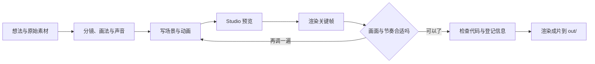
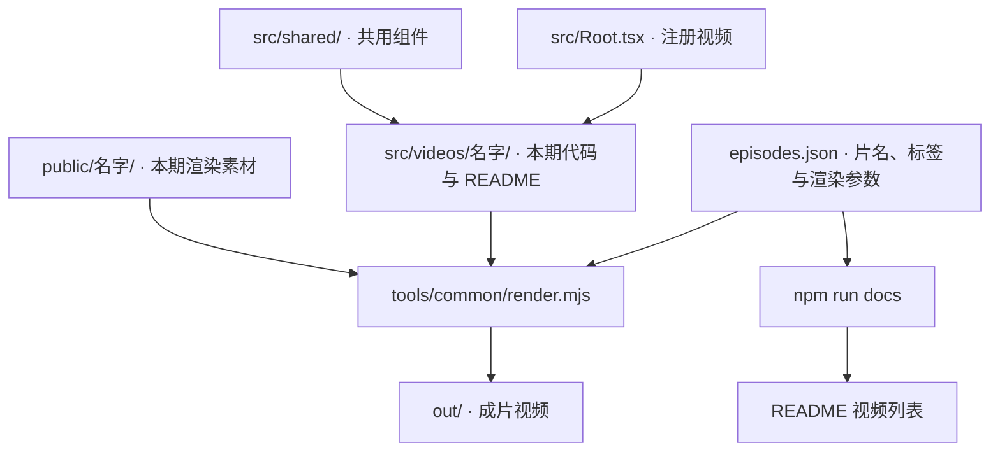
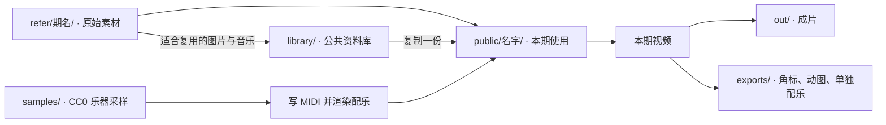
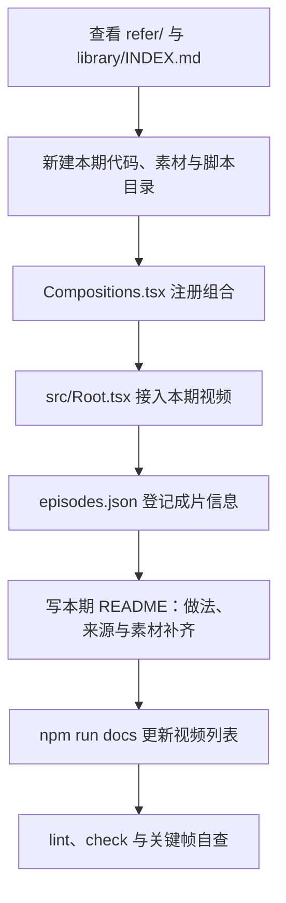

# 硅基计划 兴趣类项目 Remotion纯代码渲染视频仓库

> 用代码生成视频的仓库，记录每一次想法

***


***

> tags: [Remotion, React, Three.js, 着色器, 视频制作, AI Coding]

> date: 2026-10-11

> github: https://github.com/pluchon/vedio_studio_remotion_personal

项目介绍、日常片段、天文科普，都在这个 Remotion 工程里做。每一期有自己的代码和素材，共用依赖、组件和工具。

画法跟着主题走：线稿、手帐、像素、2D 着色器、3D、体积渲染都试过，也会在一支片子里混着用。当前使用 Remotion 4.0.529、React 19 和 rspack。

## 一支视频怎么做



## 快速开始

```bash
npm install
npm run dev
```

克隆后先看目标视频的 README，按里面的说明补齐本机素材。公开仓库不包含所有配乐、照片和念白。

```bash
npm run render -- --list       # 列出成片 ID
npm run lint                  # ESLint + 类型检查
npm run check                 # 检查登记、文档与素材目录
npm run render -- Hello       # 按登记参数渲染到 out/hello.mp4
```

渲染脚本会自动读取 `episodes.json` 中的参数。三维片子先看样帧，整片渲染会占用较多时间和机器资源。

## 视频列表

点成片 ID 可以看这一期的做法、来源和素材补齐说明。列表来自 [episodes.json](https://github.com/pluchon/vedio_studio_remotion_personal/blob/main/src/videos/episodes.json)，修改登记后运行 `npm run docs`。

按题材或技术找片子：`rg -i '体积渲染' src/videos/episodes.json`。

| 期 | 成片 ID | 片名 | 时长 | 一句话 | 标签 | 渲染参数 |
| --- | --- | --- | --- | --- | --- | --- |
| 0 | [`MohengOJ`](https://github.com/pluchon/vedio_studio_remotion_personal/blob/main/src/videos/moheng-oj/README.md) | 墨衡 OJ 介绍 | 120 秒 | 项目介绍视频：网页截图做成图版，镜头推拉，朱砂圈注 | 项目介绍、网页截图、图版推拉 | — |
| 1 | [`WindDiary`](https://github.com/pluchon/vedio_studio_remotion_personal/blob/main/src/videos/wind-diary/README.md) | 风经过的地方 | 约 90 秒 | 日常生活三则：2D 程序化画面、手写式字幕、拍立得 | 日常、2D、手写字幕、拍立得 | — |
| 2 | [`CloudSky`](https://github.com/pluchon/vedio_studio_remotion_personal/blob/main/src/videos/cloud-sky/README.md) | 云走过的地方，天空都记得 | 77 秒 | 一团团叠起来的云与形变 | 日常、2D、云、形变 | — |
| 3 | [`LookingUp`](https://github.com/pluchon/vedio_studio_remotion_personal/blob/main/src/videos/looking-up/README.md) | 我们一直在仰望 | 5 分钟 | 人类仰望星空的历史，32 幕，按年代换画法（铜版画、海报、写实深空、光与回路），three.js 3D | 天文、历史、three.js、多种画法、铜版画 | `--gl=angle` |
| 4 | [`Horizon`](https://github.com/pluchon/vedio_studio_remotion_personal/blob/main/src/videos/horizon/README.md) | 光到不了的地方 | 132 秒 | 一个镜头跨二十多个数量级，真实星表与巡天数据，three.js | 天文、three.js、真实数据、星表、单镜头 | `--gl=angle` |
| 5 | [`Rain`](https://github.com/pluchon/vedio_studio_remotion_personal/blob/main/src/videos/rain/README.md) | 一场雨 | 30 秒 | 画面由配乐波形驱动，噪声、路径动画、弹簧，首尾循环 | 日常、配乐驱动、噪声、路径动画、循环 | — |
| 6 | [`Moe`](https://github.com/pluchon/vedio_studio_remotion_personal/blob/main/src/videos/moe/README.md) | 萌系手帐 | 82 秒 | 手帐底图里嵌动漫镜头，换镜头跟着配乐的起音，一格一格动的步进动画 | 手帐、动漫、配乐驱动、步进动画 | `--color-space=bt709` |
| 7 | [`Amazon`](https://github.com/pluchon/vedio_studio_remotion_personal/blob/main/src/videos/amazon/README.md) | 亚马逊河 | 82 秒 | 真实高程、河网和卫星底图铺成的三维地图，着色器算光影、雾和河面，亮线沿河道画到入海口 | 地理、着色器、真实数据、三维地图 | `--gl=angle --color-space=bt709 --concurrency=2` |
| 8 | [`Hanzi`](https://github.com/pluchon/vedio_studio_remotion_personal/blob/main/src/videos/hanzi/README.md) | 汉字的演变 | 88 秒 | 人声念白加逐字字幕，八个字从甲骨文化成楷书，字形之间靠「离笔画边缘的距离」互相变 | 汉字、人声念白、逐字字幕、字形变形 | `--color-space=bt709` |
| 9 | [`ThatDay`](https://github.com/pluchon/vedio_studio_remotion_personal/blob/main/src/videos/that-day/README.md) | 那一天 | 约 1 分钟，随留言长短变 | 输入日期和地点，算出那天的日出日落、星空、月相和地球的位置；可换参数，另可导出透明角标、月相动图和单独的配乐 | 天文、参数化、Skia、Lottie、可导出 | `--color-space=bt709` |
| 10 | [`Hello`](https://github.com/pluchon/vedio_studio_remotion_personal/blob/main/src/videos/hello/README.md) | 你好，我是 Claude | 约 130 秒 | Claude 的自我介绍：像素小螃蟹从头讲到尾，转场、镜头推拉、分层布景、颜文字，芯片音乐 | 角色、像素、转场、芯片音乐、颜文字 | `--gl=angle --color-space=bt709` |
| 11 | [`Edge`](https://github.com/pluchon/vedio_studio_remotion_personal/blob/main/src/videos/edge/README.md) | 宇宙的尽头 | 约 3 分 37 秒 | 朋友的朗读配一张不断被重画的老地图（全 SVG 墨线）；古地图海怪、哈勃和韦伯的真实照片；深空氛围配乐 | 天文、人声念白、SVG、古地图、真实照片 | `--color-space=bt709` |
| 12 | [`Nebula`](https://github.com/pluchon/vedio_studio_remotion_personal/blob/main/src/videos/nebula/README.md) | 星云 | 约 5 分 48 秒 | 朋友的朗读，放松助眠的科普：体积渲染把地球的云一路画成宇宙的云，目镜、光谱、行星状星云、极光；全是自己算的 3D；摇篮曲配乐 | 天文、人声念白、体积渲染、three.js、着色器、助眠 | `--gl=angle --color-space=bt709 --concurrency=3` |
| 13 | [`Attractor`](https://github.com/pluchon/vedio_studio_remotion_personal/blob/main/src/videos/attractor/README.md) | 巨引源 | 约 6 分 44 秒 | 放松助眠的科普：从床上的夜空升到银河系，用真实的微波背景、2MRS 和 Cosmicflows-4 数据自己建模，论文页上划线标注，讲「巨引源」这三十多年的追寻；你自己录的念白（压低压沉），深邃静谧配乐循环续长 | 天文、真实数据、论文标注、three.js、着色器、助眠 | `--gl=angle --color-space=bt709 --concurrency=3` |

## 代码和素材放哪里





开新一期先看 [library/INDEX.md](https://github.com/pluchon/vedio_studio_remotion_personal/blob/main/library/INDEX.md)。资料库只收有真实来源的图片与音乐，不收生成图片、念白或文章；使用时复制到本期目录。静帧、测试渲染和日志放仓库外的临时目录。

本期脚本放 `tools/<名字>/`，跨期工具放 `tools/common/`。共用组件的颜色和样式通过参数传入。

## 通用工具（`tools/common/`）

| 工具 | 用法 |
| --- | --- |
| `render.mjs` | `npm run render -- <成片ID> [额外参数]`；参数来自 `episodes.json`；要传参数的片子（如 `ThatDay`）追加 `--props=<json>` |
| `docs.mjs` | `npm run docs`：重写上面的视频列表 |
| `check.mjs` | `npm run check`：检查视频登记、各期 README、组合 ID、视频列表与资料库目录 |
| `stills.mjs` | `node tools/common/stills.mjs <输出目录> <组合ID:帧>... [--gl=angle] [--props=<json>]`，批量渲染静帧自查 |
| `shoot.mjs` | `node tools/common/shoot.mjs <site.json> <清单.json> <输出目录> [名字...]`，批量截图（puppeteer + 本机 Chrome），用法见 `src/videos/moheng-oj/README.md` |
| `fetch_samples.py` | `python tools/common/fetch_samples.py <VCSL 或 VSCO-2-CE> "<乐器文件夹>" [--match 字样]`，按需下 CC0 乐器采样到 `samples/`；`--list` 看有哪些 |
| `midi_render.py` | `python tools/common/midi_render.py demo <输出.wav>`；用 sfizz 和 `samples/` 中的 CC0 乐器采样渲染 MIDI，具体接口见脚本 |
| `separate.py` | `python tools/common/separate.py <音频> [输出目录] [--keep-vocals]`，用 Demucs 去掉人声留下配乐；Demucs 装在仓库外，安装命令写在文件开头，换了位置设 `DEMUCS_PYTHON` |

## 新增一个视频



`Compositions.tsx` 用 `<Folder>` 包住本期组合，组合 ID 带视频前缀。素材通过本期 `theme.ts` 的 `asset()` 拼路径。

关键帧示例，输出目录放在仓库外；三维画面加 `--gl=angle`：

```bash
node tools/common/stills.mjs <输出目录> Hello:120 --gl=angle
```

配乐先找有授权的现成曲子，需要原创时写 MIDI，用 CC0 真实采样和 sfizz 渲染。早期的 `music.py` 波形合成脚本保留作历史，后续不沿用。

## 不入库的东西

仓库是公开的。有版权的配乐、个人照片、朋友录的念白和本机生成的配乐不入库；`refer/`、`samples/`、成片与其他导出也不入库。`library/` 只提交 README 和 INDEX。

每一期缺哪些素材、克隆后怎么补齐，都写在本期 README 里。素材的来源、许可和署名也放在那里。
