# 做小游戏：果冻 2048 和鹈鹕骑车是怎么做出来的

> 游戏大厅里的两个小游戏都没用游戏引擎，也没有一张贴图、一个模型文件。这篇用几张流程图讲讲它们大概是怎么转起来的

***

***

> tags: [游戏开发, Three.js, Web Audio, Claude Code, AI Coding]

> date: 2026-11-14

## 先说在前面

游戏大厅现在住着两个小游戏：一个是会挤会弹的 [果冻 2048](/game/jelly-2048/)，一个是骑着单车穿过十六处风景的 [鹈鹕骑车](/game/pelican-ride/)。

和上一篇讲视频的那篇一样，代码不是我手写的，而是由 Claude Code（Opus 5.5）完成。我负责的部分主要是提需求、实际试玩、截图反馈，以及指出哪里手感不对。所以这篇文章不逐行拆代码，只把两个小游戏「大概是怎么跑起来的」梳理一下，给想用 AI 试着做小游戏的朋友做个参考。

两个游戏都延续了本站的纯静态原则：没有后端，成绩只存在浏览器的 localStorage 里，因此也没有排行榜。

| | 果冻 2048 | 鹈鹕骑车 |
| --- | --- | --- |
| 画面 | Canvas 2D | three.js（WebGL） |
| 物理 | 手写的位置动力学软体 | 手写的「沿着路」的简化物理 |
| 美术 | 全靠代码画，没有图片 | 全是几何体拼的，没有贴图和模型 |
| 声音 | Web Audio 现场合成 | 真实乐器采样提前渲染成 mp3 |
| 外部资源 | 没有 | 17 个 mp3，放在 OSS 上 |
| 代码量 | 约 2300 行 | 约 1 万行，外加 800 多行生成音频的 Python |

两个游戏的时间线大概是这样：

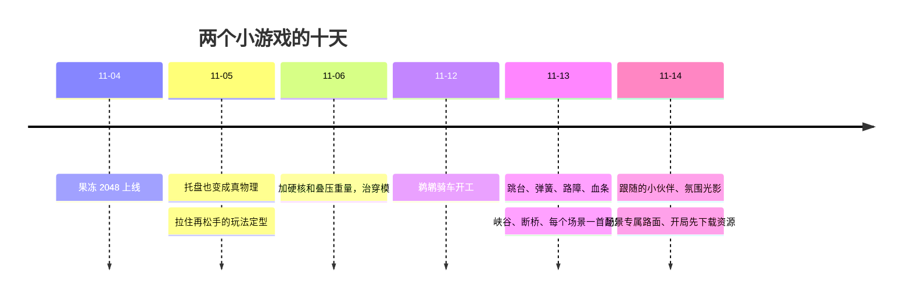

## 我们是怎么配合的

两个游戏的做法几乎一样，一轮一轮地来。我每次玩完列一串问题（有时候十几条），Claude 改完自己在浏览器里截图检查，再交给我玩下一轮。

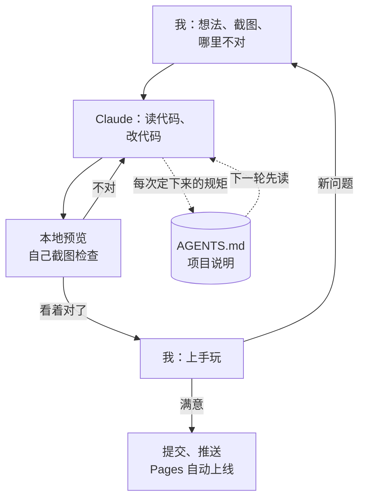

最重要的是右下角那个 `AGENTS.md`。每次我否掉一个做法（比如「别从路边横着漂移入场」「极光别做成条带」），它都会写进这份说明里，连同为什么。对话会被压缩、会换新的会话，但这份说明一直在，下一轮先读它，就不会把我否过的东西又改回去。

## 果冻 2048

规则还是 2048：相同的数字合成更大的。不一样的是，数字是一块块软乎乎的果冻，会挤、会被压扁、会 Q 弹。

### 每个果冻是一圈点

没有引入现成的物理引擎。每个果冻由一圈首尾相连的质点组成，每一小步先让它们按速度和重力自由运动，再通过几条约束把形变拉回合理范围。这种做法叫位置动力学（Position Based Dynamics），好处是数值稳定，怎么砸都不容易炸开。

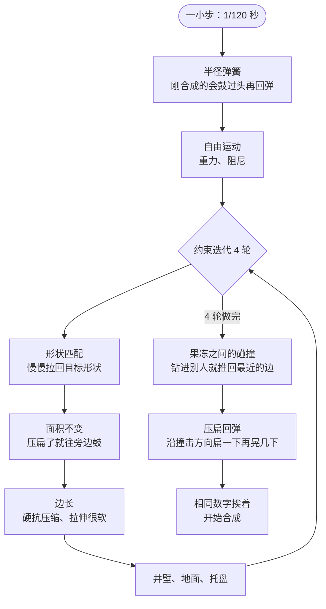

几个让它「像果冻」的小细节：

- **面积不变**相当于内部有压强，被上方压扁时体积不变，就会往两侧鼓出去，看起来就像果冻一样软塌塌地摊在地上
- **形状匹配拉得很慢**，所以落地或被砸中后会来回晃好几下才稳住
- **碰撞推开的量按质量分摊**，大果冻砸进堆里，两边都会被压扁，动量也跟着分摊过去
- 光靠软外壳的话，大果冻压在小果冻上容易直接穿模，所以每个果冻中心还塞了一颗**不能重叠的硬核**，叠压时下面那颗会按高度差加重、充当地基

画面那边按固定的 1/120 秒一步往前推，一帧最多补四步，电脑卡的时候宁可慢一点，也不越补越卡。

### 拉住再松手

果冻不是拖着走的，而是像弹弓：按住只往外拉出一个小突起（像细胞伸伪足），松手顺着「果冻到手指」的方向弹出去。

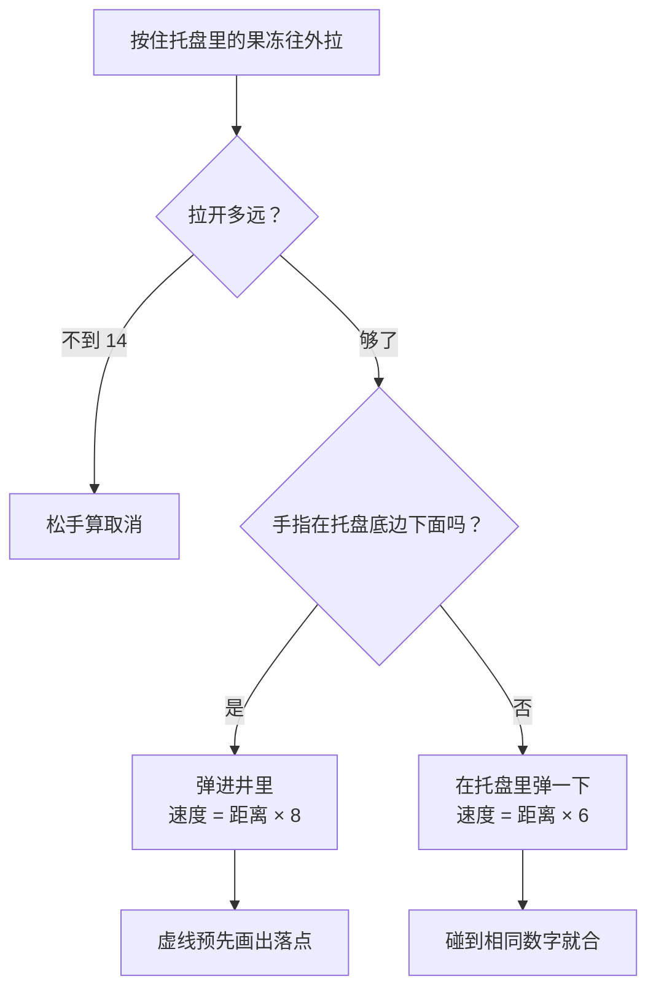

拉的时候那条虚线是用同一套物理提前模拟出来的落点，所以「指哪打哪」。

### 合成、连锁和输

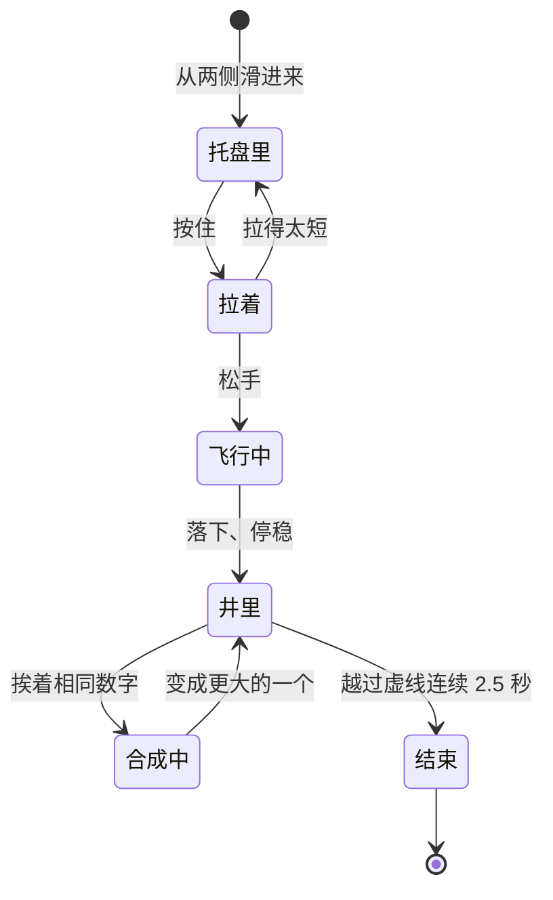

- **连锁一步一步来**：刚合出来的果冻有 0.22 秒的冷却，不会一下子全合完；连锁时画面会慢放，连得越多越慢，「噔」声一声比一声高
- **虚线有容错**：果冻晃的时候会擦过线，所以越过 6 个单位以上、落下 0.9 秒以后、连续 2.5 秒才算输
- **出块不是纯随机**：托盘只来 2、4、8，借了 Threes! 的「牌堆」做法，一副 12 张（6 张 2、4 张 4、2 张 8）洗乱了抽，抽完再洗；从哪一侧进来也是这样一个小袋子。所以不会连来五个 2，也不会很久不来 8
- **误刷新不丢局**：关页面、刷新时存一份进度，15 分钟内回来接着玩

### 「噔」是现场合成的

果冻 2048 的声音只有合成时那一声「噔」，没有使用音频文件，而是用 Web Audio 实时生成的：主体是一个三角波，起音时把音高略微拉高再在 30 毫秒内落回，模拟出轻敲的质感；接着过一道低通滤波削掉多余的高频泛音，底下再垫一层低八度的正弦波增加厚度。连续合成时音高沿着五声音阶往上走，听起来不会刺耳。

## 鹈鹕骑车

从车后面看的兜风游戏：一条长路连着十六处风景，每处 900 米，车自己往前骑，你挑车道、吃小鱼、穿金圈、飞过断桥。

### 代码怎么分

最关键的一刀是把「算」和「画」分开。路线、物理这几个文件完全不碰 three.js，可以脱离画面，直接用 Node 跑模拟：比如断桥的缺口能不能飞过去，就是让一辆虚拟的车用各种速度、各种骑法跑上几百遍，看落点。

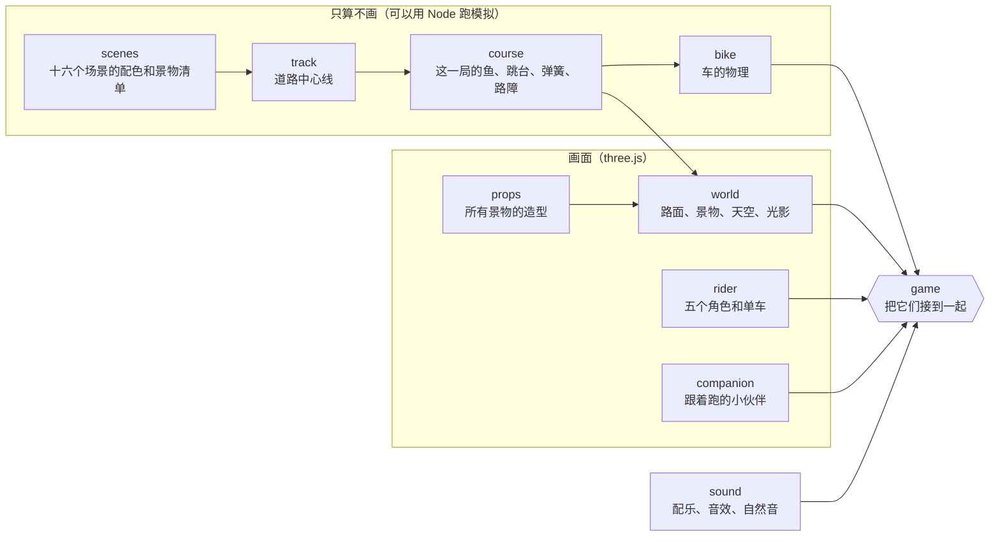

### 一局路线是怎么生成的

每局都不一样：场景顺序重新洗，路的弯法换个种子重新生成，整条路重建一遍大约 0.1 秒。

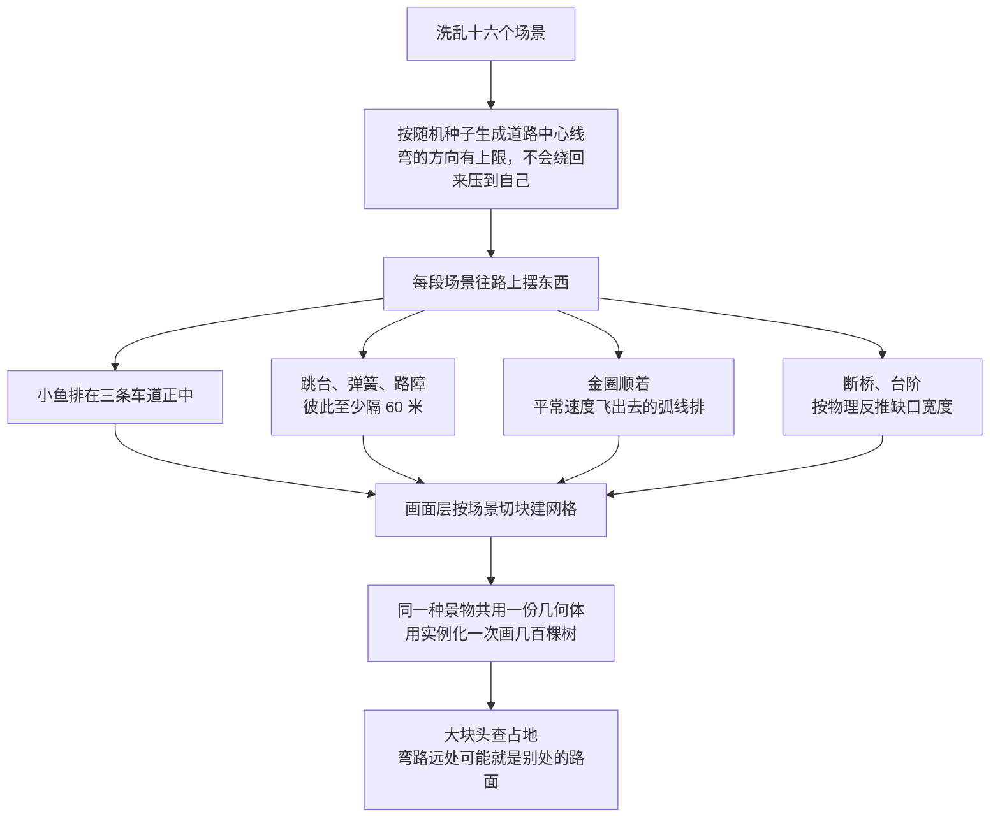

最后一条是实际踩坑后加上的：因为路是弯的，直线距离两百米外的地方，顺着路绕一圈可能正好是后面的赛道，不做占地检测就会把山直接摆在路面上。

### 车的物理只有五个数

车并不是一个真的刚体，它的状态只有五个数：沿路走了多远、离路中线多远、倾角、速度、离地多高。

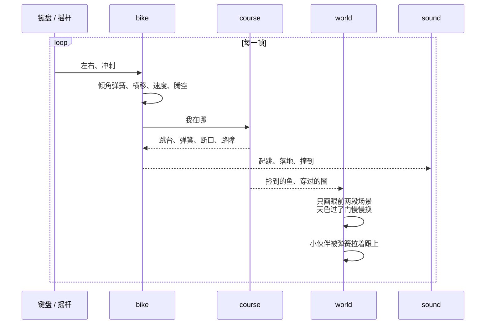

倾角是一根略带欠阻尼的弹簧，松开按键后会多晃一下，骑车时那种微微摇晃的手感就是这么调出来的。小伙伴（海鸥、鹰、洞里的小光团）同样挂在一根弹簧上，被拉向鹈鹕身边一个会慢慢游移的目标点，所以转弯时会被甩出去一点再追回来。

### 画面：全是几何体，光影靠后期

场景里的物体基本都是用圆锥、方块和球体拼出来的，按面直接上色，走的是扁平低多边形风格。观感上主要靠后面这几步后期处理：

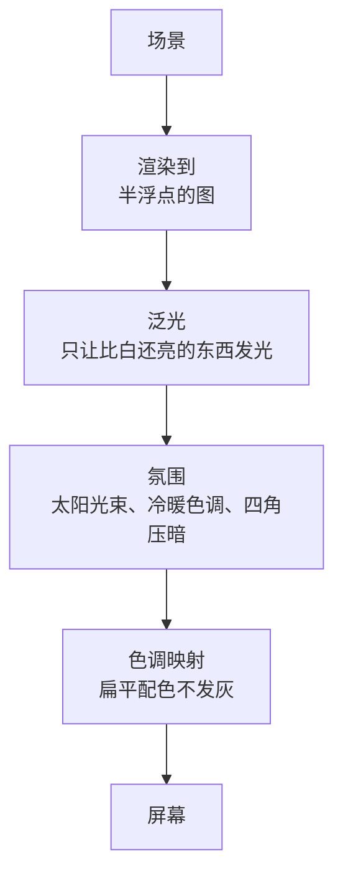

- 窗户、路灯、霓虹、金鱼这些发光材质画得比白亮 1.7 倍，泛光只认它们，别的地方不会糊
- 傍晚的光束是从画面上太阳的位置往外沿线采样，树和山挡住的地方自然是暗缝
- 画质分四档，平均一帧超过 24 毫秒就降一档，**只降不升**，免得在两档之间来回抖；手机从第二档起步，只画眼前两段场景

### 声音：用真实乐器提前渲染

鹈鹕骑车最早也试过代码实时合成音效，但听起来太机械、电子味太重。后来干脆改用真实乐器的采样（CC0 的钢琴、长笛、竖琴、弦乐组等）提前渲染成 mp3：

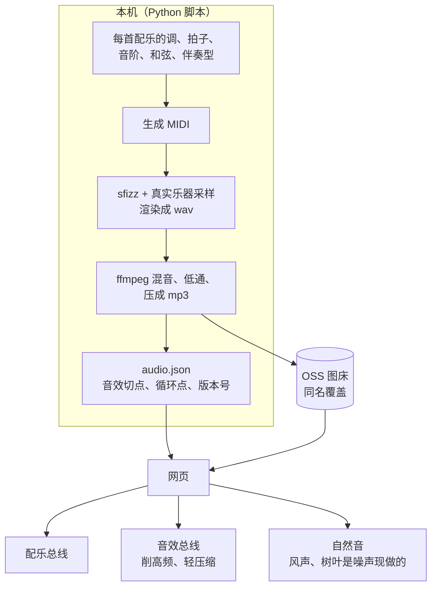

每个场景都有一首独立的配乐，风格各不相同：花田是三拍子圆舞曲，樱花用了日本音阶，沙漠是中东鼓点，峡谷里带着马蹄声。所有音效拼成一条 mp3，网页里按 `audio.json` 记录的时间点切片播放。

音量平衡我前前后后调了四五次：一开始音效太尖也太响，直接把配乐盖过去了。最后定下来的层次是背景音乐为主，捡东西和连续穿圈次之，落地、弹簧、过门这些尽量压轻，留个存在感就好。

### 开局前先把东西下好

十六首配乐加音效一共八九兆。以前是边骑边下，现在开局前先全部下完，下过的存进浏览器的 Cache Storage，下次打开几乎是秒开：

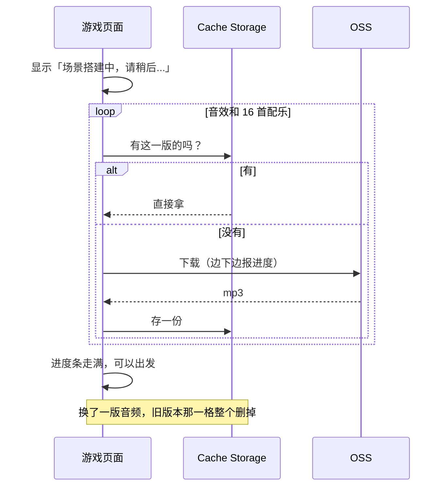

缓存按音频的版本号分格，所以换了一版音频不会拿旧文件去配新的时间点。如果网络较慢，最多等 40 秒就会跳过音频加载，先进入游戏。

## 开发过程中踩过的几个坑

| 现象 | 原因 |
| --- | --- |
| 开了泛光以后整个画面全黑 | 鹈鹕的腿和喉囊没算法线，光照算出无效值，泛光把它一圈圈糊满了全屏 |
| 开局时鹈鹕脚下套着一堆金圈 | 实例化的圈每帧只刷新车附近的，其余没摆位置，全堆在世界原点 |
| 进洞那一下卡一下 | 洞里的光团临时新建了一盏点光源，灯的数量一变，所有材质都要重新编译 |
| 跟着的海鸥落后九米、跑到镜头后面 | 弹簧的阻尼按自己的绝对速度算，车速十九米每秒时永远追不上；改成按和鹈鹕的速度差算 |
| 本地游戏页一片空白 | 开着开发服务器又跑了一次构建，依赖预构建的缓存过期；停服务、删缓存、重启就好 |
| 截图是黑的或者是旧的 | 内置浏览器窗口被隐藏时不给动画帧；所以留了个只在本地有的调试钩子，手动把画面往前推，再从画布直接导出图片 |

## 最后

回头看，做这两个游戏最花精力的其实不是把功能写出来，而是反复调手感：果冻该有多软、车子转弯晃几分、阳光和泛光到什么程度、音效压到多低，全靠自己一轮轮试玩再提修改意见。就像前面流程图里画的那样，来回磨合才是大部分时间花在上面的地方。

想玩的话，顶栏右边工具区的「游戏」图标就是游戏大厅，[果冻 2048](/game/jelly-2048/) 和 [鹈鹕骑车](/game/pelican-ride/) 都在里面。
