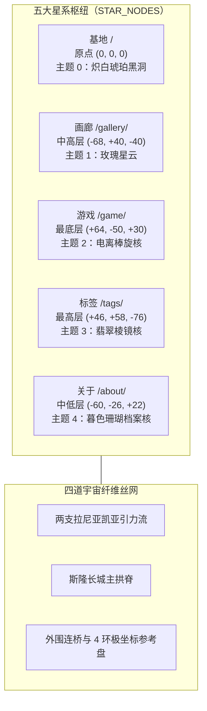
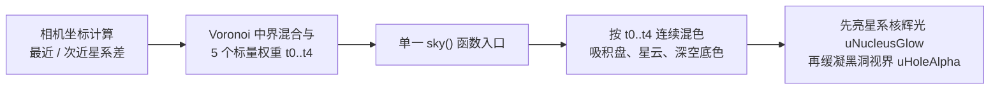
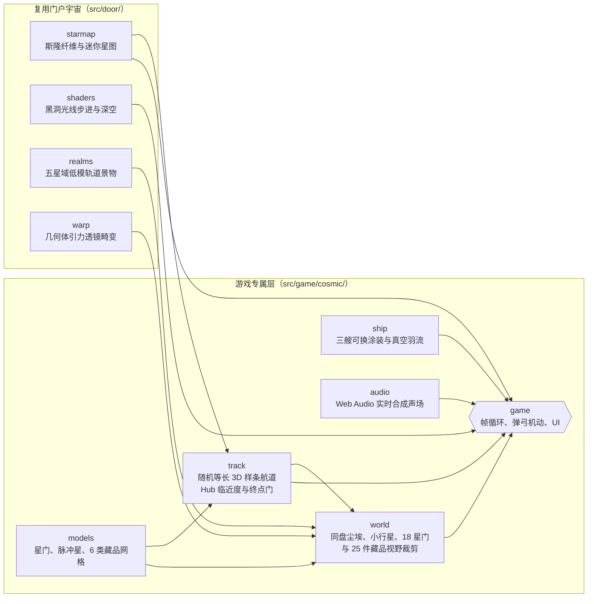
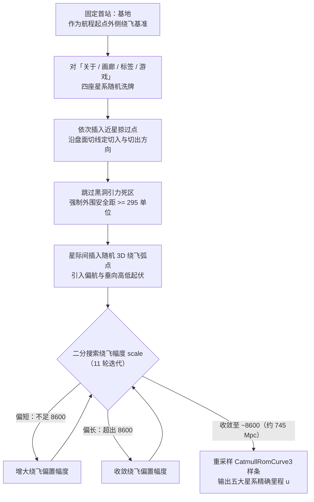
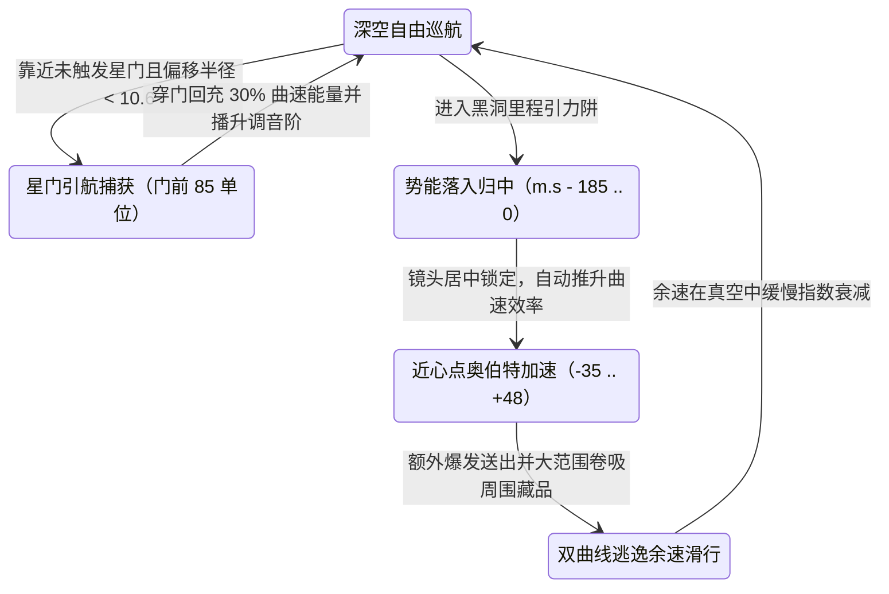
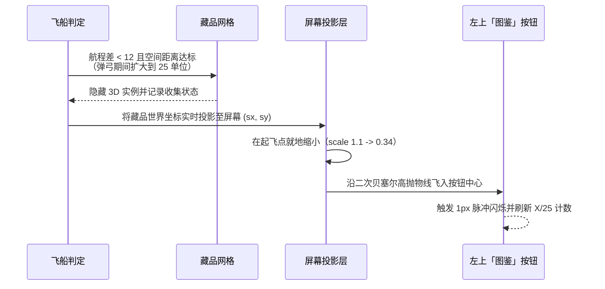

# 斯隆长城与星海漫游：门户星图和太空巡航是怎么做出来的

> 门户星图与新游戏星海漫游都靠纯代码和着色器搭起，这篇用几张流程图讲讲它们是怎么跑起来的

***

***

> tags: [游戏开发, Three.js, GLSL, Web Audio, AI Coding]

> date: 2026-11-17

## 先说来龙去脉

继 [果冻 2048](/game/jelly-2048/) 和 [鹈鹕骑车](/game/pelican-ride/) 之后，站里一直还空着第三张游戏卡。正好门户页 `/door/` 前两天刚从最初的一座黑洞升级成了**斯隆长城（Sloan Great Wall）五座星系枢纽**，整套程序生成的深空、吸积盘、轨道低模景物都已经能顺畅跑起来。

于是干脆顺着这条线往下接：一边在门户页把五个栏目映射到三维宇宙的不同高度，一边以同一个宇宙坐标系和着色器资产为底座，做了第三款纯前端 3D 游戏 [星海漫游](/game/cosmic-roam/)。全程依然**零外部模型文件、零贴图下载**，只用 `astro` 和 `three` 运行时，外加浏览器内置 Web Audio 合成所有音效。

| | 门户页 `/door/` | 星海漫游 `/game/cosmic-roam/` |
| --- | --- | --- |
| 定位 | 观测甲板 + 自由巡航 + 斯隆长城星图总览 | 沿星系长廊巡航 + 引力弹弓 + 收集游戏 |
| 星系枢纽 | 五艘探测器对应内容分类，五大星系映射基地、画廊、游戏、标签、关于 | 复用同一个 `STAR_NODES` 五大星系位置、色盘与黑洞主题 |
| 空间尺度 | 门户坐标原生尺度，对数尺从 `6 Rs` 拉到 `1.4 GLY` | 整体放大 `11.5x`（黑洞倍率 `5.4x`），总航线恒定约 `745 Mpc` |
| 轨道物体 | 五座探测器 + 外围小行星带 + 各星域轻量化低模景物 | 十八座三环星门 + 脉冲星航标 + 廿五件藏品与三艘可切换漫游艇 |
| 声音 | 静默观赏场景 | 全手写 Web Audio 合成引擎底噪、星门音阶与弹弓谐振 |

## 先建宇宙：门户页是如何扩展成「斯隆长城」的

早期 `/door/` 只有空间站甲板、一座黑洞和绕它公转的五个小探测器；后来发现这五个站点栏目完全可以放进更宏大的天文尺度里。拉远之后，画面从一座空间站展开成跨越四层高度落差、由星系纤维丝串联的五座枢纽星系。

这五个坐标点既要满足从星图总览俯瞰时的立体构图（竖屏 `aspect < 1` 时还会自动拉远 `1.22` 倍），又要保证在点击其中任意一个星系飞过去之后，画面里的深空背景和黑洞外观能平滑切换。

### 跨尺度飞行与单调用点多主题着色器

早期尝试过在片元着色器里写五个独立分支分别调用星空背景函数，结果一到第一次切换页面时，GLSL 编译器把同一段繁重的星海和星云循环内联展开了五次，导致主线程编译直接卡死好几秒。

改动之后，整个片元着色器**只保留单一 `sky()` 调用点**，改用无分支的五元权重 `t0..t4` 直接混合不同星系的星云底色与吸积盘调色板；同时借着最近与次近星系的距离差做 Voronoi 中界消融：从远处飞近时，先透出星系核辉光，再缓缓凝结出黑洞阴影和吸积盘，不再出现硬切跳变。

此外，为了防止刚进页面时被五座星系的地标几何体拖垮首帧，门户页和游戏里都采用同样的两阶段预热策略：首屏核心黑洞着色器异步 `compileAsync` 完成后再点亮画面，星图纱幕与各星域轨道低模延迟到首帧就绪后再异步挂载。

## 《星海漫游》整体模块怎么切分

到了写游戏的时候，吸取了上次做「鹈鹕骑车」的经验，我们继续把宇宙地图与可复用景物留在 `src/door/`，而在 `src/game/cosmic/` 下拆出专门负责巡航航道、飞船建模、物理判定和 Web Audio 的六个文件：

其中比较巧妙的一点是**缩放错觉**：门户页本来按宇宙尺度建模，如果要让飞船体会到「从深空远处慢慢驶近一座几十倍体量的超大质量黑洞」，把游戏中的世界坐标整体放大 `COSMOS_SCALE = 11.5` 倍、黑洞尺度放大 `HOLE_SCALE_MULT = 5.4` 倍，而把飞船缩到 `SHIP_SCALE = 0.36` 挂在紧贴尾追广角镜头前；雷达与缩略图再用 `shipPos / COSMOS_SCALE` 除回原坐标系，两边就完全对齐了。

## 核心玩法一：等总长的随机漫游航线

最开始游戏只沿一条固定顺次路过几个星系的轨道直线穿行，玩久了流程显得偏短、路也太直。用户后来提了一个很好玩的想法：**每局保证经过所有五个已知星系，但中间怎么绕由程序随机定，而且不论怎么随机，总航程都保持一致**。

`src/game/cosmic/track.ts` 里的 `buildProceduralRoute` 用两步把这个约束稳稳锁死了：

算下来，五个星系之间最短折线跨度大约四千多单位，远远小于设定的 `TARGET_TOTAL_LENGTH = 8600`，所以无论四个外围星系怎么洗牌排序，11 轮二分迭代几乎总能把整条随机航道精确收敛在 `8600 ± 20` 单位左右——而且因为黑洞、星门和藏品的位置都绑定在采样后的 `track.milestones` 和 `track.sampleAtS` 上，通关点「再来一局」时只需调用一次 `track.regenerate()` 和 `world.syncToTrack()`，不必重建整组着色器和星图网格就能开启一条全新航线。

## 核心玩法二：黑洞光学、共面尘埃与引力弹弓

早期做完场景时，用户一眼挑出两个物理学上的别扭感：黑洞附近物质显得散乱、和吸积盘不是同一个平面，飞船喷口还带着大气层里的马赫环和呼啸风声。对照天体物理和真空环境，我们集中重构了三块逻辑：

1. **所有物质共面与差速开普勒公转**：黑洞周围的分子尘埃、潮汐气流弧（`11.8..25.8 Rs`）全部严格锁进由法向与基矢定义的盘面 `(diskN, diskU, diskV)` 内，外侧在洛希/升华极限外 `30..52 Rs` 另挂一层稀疏冷硅酸盐微行星带，角速度按 $\omega \propto r^{-1.5}$ 内快外慢旋转。
2. **真真空推进与无风阻惯性**：`ship.ts` 去掉了大气层马赫菱形激波纹理，换成贴合真空离子引擎的平滑普朗特-迈耶膨胀扇面；`audio.ts` 砍掉了所有基于白噪声的破风声，改用模拟加压舱内微弱磁场谐振的正弦泛音扫频；航道横移和前向减速阻尼系数也比加速阶段轻缓很多。
3. **三段式引力弹弓与星门电磁漏斗**：

靠近星门时之前很容易从环边缘擦肩而过，后来给未触发星门加了一层柔和的横向电磁吸附漏斗：玩家正在主动大幅度变向时只给四成半辅助力度，几乎不碰方向键时则会稳稳把飞船收进环心。

## 收纳动效与交互细节

在藏品收集体验上也改过两版：第一版收集后物体直接飞向屏幕正前方放大展示，实测发现高速巡航时极其挡视线，很容易让人漏看下一道星门。

图鉴本身则复用了游戏里 `buildCollectibleCatalogGeos` 那六套 3D 几何体思路，写成轻量 SVG 等轴测线框图列在双列卡片最右侧，集齐某个星系四件藏品后整个星系栏会点亮对应主题色并挂一枚对勾。

## 踩过并修掉的几个坑

| 问题 | 根因与解决办法 |
| --- | --- |
| 门户与游戏进场景第一次转场卡住几秒 | 片元着色器多分支各自内联 `sky()` 导致 GLSL 体积膨胀；改成单一 `sky()` 调用加标量权重混色，再配合两阶段 `compileAsync` |
| 随机绕飞航道有时穿透黑洞阴影内部 | 随机偏置点落得太近；在 `buildProceduralRoute` 生成每个过渡点时显式检查离五个 `STAR_NODES` 的最小安全距离并向外推开 |
| 顶部全宽进度条既挤占按钮空间又发虚 | 最早贴在视口顶部容易被裁掉或压住顶栏；后来把进度条直接放进 `.roam__hud` 中栏左右按钮之间的空白里，用 `clip-path` 修出两端渐细的尖头流线 |
| 结算直接切出很突兀，过场速度也不对 | 改为冲进终点星门前 320 单位持续加速、穿门时保持峰值高速掠出星海约 1 秒后再渐停，随后用慢入场弹出结算卡并支持一键重新洗牌启航 |

## 最后

从去年年底先把门户页黑洞写出来，到扩成斯隆长城星图，再到今天长出「星海漫游」这款第三款 3D 游戏，站点里的每一块场景几乎都是「先用纯代码拼出一版跑起来 → 上手体验挑毛病 → 再一块块雕细节」这样长大的。

如果你想亲自飞一圈看看五座星系的黑洞与 25 件藏品，点顶栏右上角工具区的手柄图标进入游戏大厅，或者直接从 [星海漫游](/game/cosmic-roam/) 启航就行。
